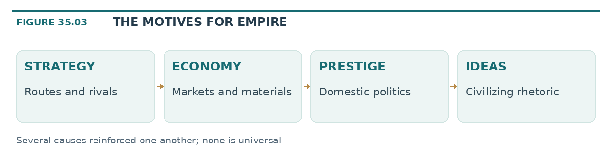

Обяснението на бъркотията често започва с европейската индустриализация. Параходът може да намали разходите за преместване на хора и стоки по плавателните пътища; телеграфите ускорени комуникации; подобренията в огнестрелните оръжия и логистиката биха могли да разширят военните различия. Индустриалните производители и инвеститори търсеха пазари, суровини и възможности за печалба. Но тези събития сами по себе си не обясняват кои места били завладени, кога или на каква цена. Други региони с печеливша търговия изпитаха различни политически резултати, а някои африкански колонии струваха повече на европейските ценни книжа, отколкото се върнаха в краткосрочен план.

Стратегическите съперничество е също толкова важно. Британските власти се грижеха за морския маршрут до Индия, достъпа през Суецкия канал и долината на Нил. Френска политика след 1870 смесени търговски амбиции, военен статут, партийна политика и стратегическа конкуренция. Германските колониални предприятия отразиха изместването на политическите изчисления и натиска от лобистите. Португалия твърди, че по-стари твърдения, Италия търси позиция сред европейските държави, а белгийският крал Леополд II провежда личен императорски проект в Конго. Местните политици понякога се отнасяли към чуждестранното притежание като към доказателство за национален престиж дори когато икономическата му стойност била оспорвана.

<figure class="figure" id="figure-35-3">

<figcaption>Фигура 35.3. Няколко причини взаимно се укрепват; нито един не е универсален. <a class="figure-anchor" href="#figure-35-3" aria-label="Link to this figure">#</a></figcaption>
</figure>

Историците съответно обсъждат тежестта на капитализма, стратегическата конкуренция, национализма, мисионерската идеология, вътрешната политика, местните африкански конфликти и контингентните събития. Обясненията си взаимодействат, вместо да се състезават в конкурс за победители. Слух за друг държавен договор може да предизвика императорска декларация; една компания би могла да изисква военна намеса; гранична война може да създаде натиск за директно приложение. Бъркотията се ускори чрез обратна връзка между политическите тревоги, възможностите, насилието и твърденията за необходимост. \[<a href="/035-imperialism-and-african-partition/sources/#source-3" class="cite">3</a>\]\[<a href="/035-imperialism-and-african-partition/sources/#source-4" class="cite">4</a>\]
