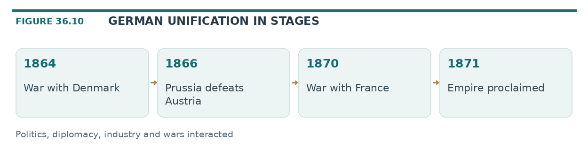

Ото фон Бисмарк става министър-председател на Прусия през 1862 на фона на спор за военна реорганизация и държавния бюджет. Той беше консервативен държавник, който използва националистически възможности, без да приеме парламентарния суверенитет. През 1864 Прусия и Австрия се бори Дания над Schleswig и Holstein. Последвалите договорености засилиха съперничеството между двете сили. През 1866 г. Прусия побеждава Австрия и нейните съюзници, разпуска немската конфедерация и организира Северната германска конфедерация под пруското ръководство. \[<a href="/036-nationalism-and-the-nineteenth-century-nation-state/sources/#source-8" class="cite">8</a>\]\[<a href="/036-nationalism-and-the-nineteenth-century-nation-state/sources/#source-15" class="cite">15</a>\]

През 1870 г. дипломатическата криза около испанския трон и редактирането на Емс Диспечер допринася за войната между Франция и Прусия и нейните германски съюзници. Военната победа и участието на южните германски държави направиха националното обединение политически осъществимо. Германската империя е обявена във Версай на 18 януари 1871 г. преди мирното споразумение с Франция. Загубата на Франция от Елзас и част от Лорейн създаде горчивина и стана основен проблем в по-късната европейска дипломация. \[<a href="/036-nationalism-and-the-nineteenth-century-nation-state/sources/#source-15" class="cite">15</a>\]\[<a href="/036-nationalism-and-the-nineteenth-century-nation-state/sources/#source-16" class="cite">16</a>\]

<figure class="figure" id="figure-36-10">

<figcaption>Фигура 36.10. Политиката, дипломацията, индустрията и войните взаимодействаха. <a class="figure-anchor" href="#figure-36-10" aria-label="Link to this figure">#</a></figcaption>
</figure>

Би било грешно да кажем, че Бисмарк обедини Германия само с "три войни." Военната реформа, нарастващата промишленост, железопътния транспорт, данъците, обществения национализъм, споразуменията между южните държави и международния баланс на властта са от значение. Също толкова погрешно би било да си представим империята като демократично постижение. Императорът, канцлерът, федералните принцове и военното командване запазиха значителна власт, въпреки че избрани институции и партии също действат в рамките на новата система.
