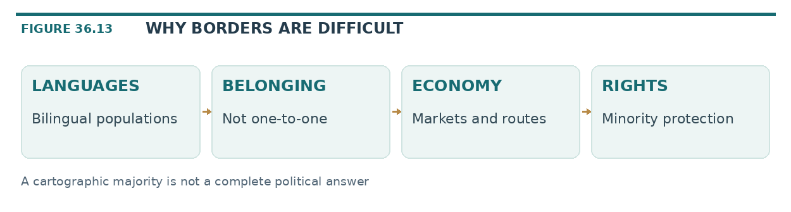

Фразата "Национално самоопределение" звучи проста, докато не се попита кое население формира единицата, която има право да избира. Градът може да има няколко езикови общности, села в същата долина могат да се идентифицират по различен начин и регионът може да съдържа стратегически важни пътища или пристанища. Ако мнозинството желае да се присъедини към една държава, какви защитни мерки трябва да получи местното малцинство? Ако едно историческо царство претендира за стара граница, трябва ли това да надвишава предпочитанията на хората, които живеят там в момента? Дипломата от 19 век рядко отговаря на такива въпроси последователно.

Карта, присвояваща един цвят на всеки език или националност, често прикрива двуезичните домакинства, браковете, сезонната миграция и градското смесване. Някои карти са използвали данни от преброяването, събрани от администрациите с интерес да представят конкретен демографски модел. Други карти разчитали на посещаване на училище или църковна юрисдикция като проксита за идентичност. В Хабсбург земи официални езикови класификации понякога насърчава хората да изберат един етикет от по-сложни набор от практики. \[<a href="/036-nationalism-and-the-nineteenth-century-nation-state/sources/#source-19" class="cite">19</a>\]

<figure class="figure" id="figure-36-13">

<figcaption>Фигура 36.13. Картографското мнозинство не е пълен политически отговор. <a class="figure-anchor" href="#figure-36-13" aria-label="Link to this figure">#</a></figcaption>
</figure>

По този начин е подвеждащо да си представим, че национализмът решава граничния въпрос чрез замяна на династични карти с "естествени." Дори когато принципът на самоуправлението получи одобрение, прилагането на териториален отговор може да доведе до нови малцинства и неравенства. Това е една от причините, поради които по-късно националните конфликти често се въртят около училища, поклонение, преброяване на населението и административни назначения, колкото армии.
