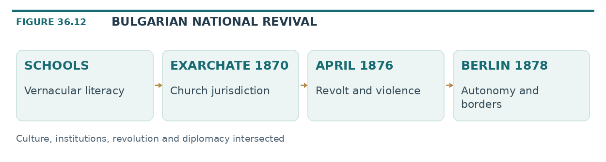

Българското национално възраждане се развива чрез промяна на търговията, народна писменост, исторически интерес, училища, религиозна организация и политическа възбуда под османско владичество. Paisii на Хилендар 18-ти век исторически писмено стана влиятелен в по-късната национална памет; деветнадесети век учители и издатели след това помогнаха за разширяване на българо-езиковото образование. Националното възраждане не било нито една институция, нито един път от книга до бойно поле. Местните общности финансираха класни стаи и църкви, а мрежите в градовете вътре и извън Османските територии подкрепяха учители, вестници и политически дебати. \[<a href="/036-nationalism-and-the-nineteenth-century-nation-state/sources/#source-24" class="cite">24</a>\]\[<a href="/036-nationalism-and-the-nineteenth-century-nation-state/sources/#source-25" class="cite">25</a>\]

Борбата за църковна автономия била особено важна. Османският указ за създаване на Българската екзархия през 1870 г. създава призната религиозна институция, свързана с българската национална организация. Но църковните и националните граници се припокривали несъвършено. Споровете, свързани с Вселенската патриаршия, Ексархията и местните сборове, често се превръщали в конкурси за език, юрисдикция и идентичност. Същото училище или църква може да се разглежда от различни актьори като образование, духовна власт или доказателства за бъдещи териториални претенции. \[<a href="/036-nationalism-and-the-nineteenth-century-nation-state/sources/#source-25" class="cite">25</a>\]

<figure class="figure" id="figure-36-12">

<figcaption>Фигура 36.12. Култура, институции, революция и дипломация се пресичат. <a class="figure-anchor" href="#figure-36-12" aria-label="Link to this figure">#</a></figcaption>
</figure>

Революционните кръгове, включително фигури като Васил Левски и Христо Ботев, преследваха освобождението с въоръжени и организационни средства. Априлското въстание от 1876 г. и последвалите репресии привличат вниманието на международната общност към насилието срещу цивилни граждани. Русо-Отоманската война от 1877 год. и Договорът от Сан Стефано предшестват ревизирания конгрес на Берлинското селище: Княжество България е автономно под управлението на Османско сузеренти, Източна Румелия остава автономна османска провинция, а други спорни области остават под турската администрация. Тези селища не могат да бъдат сведени до триумфа на един национален принцип. \[<a href="/036-nationalism-and-the-nineteenth-century-nation-state/sources/#source-25" class="cite">25</a>\]\[<a href="/036-nationalism-and-the-nineteenth-century-nation-state/sources/#source-26" class="cite">26</a>\]
