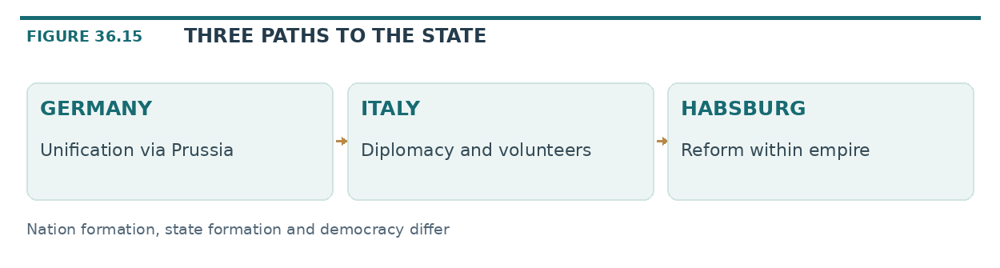

Да разгледаме три пътя един до друг. Германия се превръща в единна империя до голяма степен чрез пруски военни, дипломатически и институционални господство, изграждане на частично интегриран икономически пейзаж. Италия се появи чрез комбинации от доброволчески кампании, държавна власт на Пиемонт, плебисцити, войни и дипломатически възможности. Хабсбургските и османските империи се опитаха да се реформират и да имат общо политическо членство, докато се изправят срещу конкурентните национални претенции. Нито един от тези резултати не е бил просто автоматичен резултат от хора, които споделят език. \[<a href="/036-nationalism-and-the-nineteenth-century-nation-state/sources/#source-13" class="cite">13</a>\]\[<a href="/036-nationalism-and-the-nineteenth-century-nation-state/sources/#source-15" class="cite">15</a>\]\[<a href="/036-nationalism-and-the-nineteenth-century-nation-state/sources/#source-17" class="cite">17</a>\]\[<a href="/036-nationalism-and-the-nineteenth-century-nation-state/sources/#source-21" class="cite">21</a>\]

Сравнението изяснява разликата между национална формация, държавно формиране и демократизация. Националните активисти могат да култивират колективна идентичност. Нова държава може да консолидира данъчното облагане, училищата и военната власт. Демократическата реформа определя кой има глас в тези решения. Тези процеси могат да се подсилват взаимно, но също така могат да се движат в противоположни посоки. Обединението може да направи едно правителство по-силно, докато стеснява свободата на групите, които не са съгласни с неговите граници.

<figure class="figure" id="figure-36-15">

<figcaption>Фигура 36.15. Формирането на нацията, държавното формиране и демокрацията се различават. <a class="figure-anchor" href="#figure-36-15" aria-label="Link to this figure">#</a></figcaption>
</figure>

Четвърти случай, Франция, обръща част от поредицата: отдавна установена държава работи за създаване на по-стандартизирана масова национална идентичност. Една пета, Полша, показва как националната идентичност може да издържи въпреки загубата на суверенитет. Една шеста, Ирландия, показва конкурентна национална лоялност в една държава. Това сравнение е по-полезно от опитите да се подредят всички движения по един единствен мащаб от "напреднали" до "назад."
