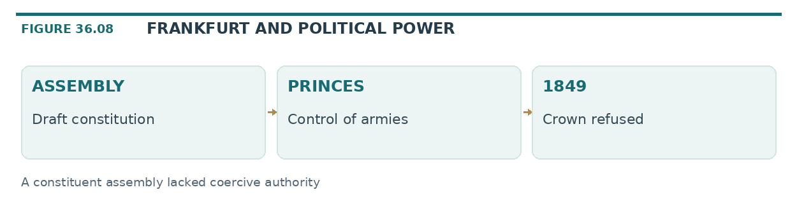

Делегатите на Народното събрание във Франкфурт се срещнаха през 1848 г., за да обсъдят конституционното обединение на Германия. Те не бяха съгласни по отношение на монархията и републиката, избирателността, разпределението на властта между централните власти и страните-членки, както и дали разширена Германия може да включва австрийски територии. Опцията "По-велик германец" се сблъска с реалността, че австрийските владетели управляват обширни негермански земи; решението "Lesser German" центрира по-ясно върху Прусия. \[<a href="/036-nationalism-and-the-nineteenth-century-nation-state/sources/#source-8" class="cite">8</a>\]\[<a href="/036-nationalism-and-the-nineteenth-century-nation-state/sources/#source-12" class="cite">12</a>\]

Асамблеята изготвя конституция и през 1849 г. предлага императорската корона на Фредерик Уилям IV от Прусия, който отхвърля предложения конституционен маршрут. Нейната липса на независима принудителна сила, съпротивата на големите принцове и променящите се революционни условия фатално ограничиха експеримента. Провалът не показа, че национализмът изисква диктатура. Тя показа, че политическите идеали без ефективен контрол на армиите, финансите и административните институции са уязвими.

<figure class="figure" id="figure-36-8">

<figcaption>Фигура 36.8. На съставното събрание му липсваше принудителна власт. <a class="figure-anchor" href="#figure-36-8" aria-label="Link to this figure">#</a></figcaption>
</figure>

По-късно германско обединение под пруското ръководство понякога се описва като триумф на "кръв и желязо" над "речове и мажоритарни решения." Този лозунг замъглява истинската сила на по-ранните парламенти, гражданските общества и търговските мрежи, но подчертава контраста между опит за конституционно събрание и по-късни междудържавни военни и дипломатически действия. Националното единство може да бъде създадено от владетели, които не са искали да признаят парламентарно превъзходство.
