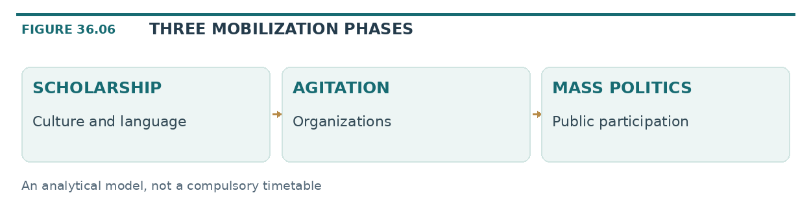

Сравнителният модел на Хрох описва фази, през които някои национални движения се движат: научно изследване на езика и историята; организирана патриотична възбуда; и по-широко масово участие. Това са полезни аналитични категории, а не универсален график. Едно движение може да придобие популярна енергия, преди неговите учени да установят езикови стандарти и правителствата могат да попречат на възбудата или да променят целите ѝ. Моделите следва да бъдат тествани по отношение на действителните случаи, вместо да се прилагат механично. \[<a href="/036-nationalism-and-the-nineteenth-century-nation-state/sources/#source-5" class="cite">5</a>\]

Един малък кръг от учители и духовници може да отпечата учебници и да създаде читални зали; търговците биха могли да финансират вестници; адвокатите биха могли да формулират конституционни претенции; връщането на мигранти може да донесе нови политически речници. Някои елити възприеха национализма, защото му предложиха по-широко представителство и възможности. Други елити се страхуваха да не загубят привилегиите си, свързани с императорската служба, местната автономия или космополитния език. Така политическата идентичност се развива чрез договаряне, както и ентусиазъм.

<figure class="figure" id="figure-36-6">

<figcaption>Фигура 36.6. Аналитичен модел, а не задължителен график. <a class="figure-anchor" href="#figure-36-6" aria-label="Link to this figure">#</a></figcaption>
</figure>

Представете си две съседни области, където жителите говорят подобни диалекти, но получават различни училища, данъчни правила и вестници. Повече от две поколения те могат да се идентифицират с различни политически нации. Обратно, хората, говорещи различни езици, могат да споделят траен държавен патриотизъм. Това не означава, че всички идентичности са взаимозаменяеми; това означава, че политическите институции могат да засилят или отслабят определени начини на принадлежност.
