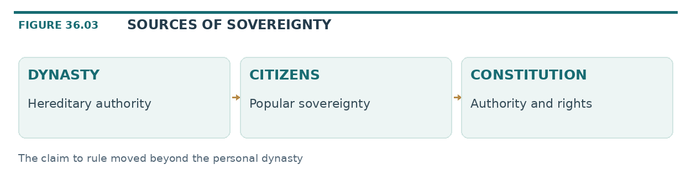

Преди деветнадесети век много владетели оправдавали властта чрез династия, религия, наследствен закон или териториален прецедент. Императорът на Хабсбург, кралят на Бурбоните или османският султан управлявали хора, които говорели много езици. Политическите права могат да бъдат ограничени чрез собственост, собственост, религия или местна привилегия. Съвременните националисти поставиха под въпрос защо семейството на владетеля трябва да определи политическата съдба на един народ, въпреки че някои бяха напълно готови да поставят национален монарх на трона след като бъде спечелена независимостта.

Американските и френските революции оспорват наследственото върховенство по различни начини. Френският език на нацията като източник на политическа власт, както и назначаването на граждани в масови армии, помогнаха да се превърне националната лоялност в въпрос на обществен живот. Кампаниите на Наполеон след това разпространяват правни реформи и административни промени, като същевременно провокират съпротива срещу френското господство. Понякога хората научават национализма чрез опита да бъдат управлявани от чужда империя, а не чрез абстрактни философски текстове. \[<a href="/036-nationalism-and-the-nineteenth-century-nation-state/sources/#source-7" class="cite">7</a>\]

<figure class="figure" id="figure-36-3">

<figcaption>Фигура 36.3. Претенцията да управляваш е отвъд личната династия. <a class="figure-anchor" href="#figure-36-3" aria-label="Link to this figure">#</a></figcaption>
</figure>

Национализмът и конституционният либерализъм често стават съюзници: и двете могат да се противопоставят на произволни династични правила. Но те също могат да се противопоставят. Ако "нацията" е суверенна, кой се брои за член? Ще има ли езиково малцинство равни граждански права? Жените, бедните или колониалните субекти са включени? Една нация може да поиска свобода от една империя, като я откаже на съседните народи. Тези въпроси ще се повторят в тази глава.
