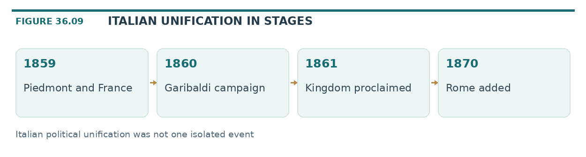

През 1860 Гарибалди води експедицията на хилядите в Сицилия, където неговите доброволци оспорват Бърбън правило. Техните успехи се разшириха в южната част на континентална Италия и помогнаха за срутването на Царството на двете сицили. Революционната републиканска репутация на Гарибалди създава трудности за консервативните и умерени поддръжници на единството. Кавур и Пиемонтската монархия се преместили да приведат юга в кралска рамка, вместо да позволят да се появи независим революционен режим. \[<a href="/036-nationalism-and-the-nineteenth-century-nation-state/sources/#source-13" class="cite">13</a>\]\[<a href="/036-nationalism-and-the-nineteenth-century-nation-state/sources/#source-14" class="cite">14</a>\]

През март 1861 г. Кралство Италия е обявено под името Виктор Емануел II. Територията му все още е непълна от стандартите на много националисти: Venetia се присъедини през 1866 и Рим през 1870 г., след като френската защита на папското правителство отслабна по време на Франко-пруската война. Ето защо процесът имаше няколко важни събития, нито един момент, когато всички италианци изведнъж придобиха едно и също гражданство и лоялност.

<figure class="figure" id="figure-36-9">

<figcaption>Фигура 36.9. Италианското политическо обединение не беше едно изолирано събитие. <a class="figure-anchor" href="#figure-36-9" aria-label="Link to this figure">#</a></figcaption>
</figure>

Щатите не са прекратили разделението. Разликите в данъчното облагане, регионалната администрация, военната служба, земята, бедността и диалекта остават големи. Съпротивата и бригандажът на юг се развиха в сложен контекст, който включваше местна лоялност, социален стрес, престъпни мрежи и антидържавно насилие. Опростяването му като чиста борба за освобождение или просто престъпление пренебрегва тези припокриващи се причини. Правенето на Италия като държава не направи автоматично интегрирано италианско общество.
