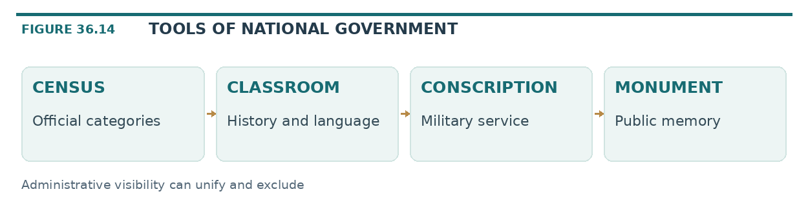

Съвременните държави са придобили по-силни инструменти за преброяване и организиране на населението. Графики на преброяването, документи за самоличност, военни регистри, карти и статистически служби позволиха на служителите да видят обществото в по-стандартизирани категории. Това би могло да подпомогне общественото здраве, инфраструктурата и последователната администрация. Тя може също така да окаже натиск върху хора, чиито форми на идентичност не съвпадат с официалните кутии или чиито местни езици са неудобни за центъра. \[<a href="/036-nationalism-and-the-nineteenth-century-nation-state/sources/#source-19" class="cite">19</a>\]\[<a href="/036-nationalism-and-the-nineteenth-century-nation-state/sources/#source-29" class="cite">29</a>\]

Абонаментът запозна много мъже с офицери, регулации и връстници от други области. Стандартизираното образование преподава национална география и споделени исторически разкази. Национални празници и възпоменания почитат избрани основатели и битки. Конструкцията на паметника превърна обществени площади в изявления на колективна памет. Това не били магически методи на единство; те можели да се сблъскат със съпротивление, да създадат скука или да станат обекти на конкурентни интерпретации.

<figure class="figure" id="figure-36-14">

<figcaption>Фигура 36.14. Административната видимост може да обедини и изключи. <a class="figure-anchor" href="#figure-36-14" aria-label="Link to this figure">#</a></figcaption>
</figure>

Източниците изискват внимателно четене. Преброяването, което съобщава 100 000 оратори от един език, може да отразява зададените въпроси, практиките на изброяващите и дали са разрешени двуезични отговори. Един доклад на държавното училище може да измерва записването по-надеждно от това колко дълбоко учениците приеха неговото патриотично послание. Клетвата на една армия разкрива идеалите, които властите искаха новобранците да следват, а не непременно това, в което всеки новобранец вярваше.
