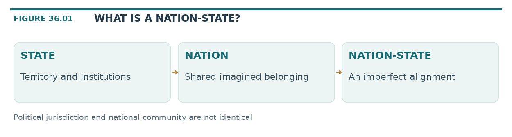

Една държава е трайна система от политически институции, която претендира за власт над територия и население. Нацията е общност, чиито членове се смятат за свързани с някаква комбинация от история, политическа идентичност, култура, език, спомени или споделена съдба. Една нация-държава е идеал, в който границите на политическата власт и националната общност са тясно изравнени. Това са аналитични дефиниции, а не тестове, с които всеки е съгласен кой принадлежи. Държавите могат да съдържат няколко национални общности; една нация може да бъде разпространена в повече от една държава; едно лице може да принадлежи към няколко общности едновременно.

<em>Национализъм</em> е широкото семейство от твърдения, че една нация заслужава признание, лоялност или политически израз, често чрез самоуправление. Тя може да бъде насочена срещу чуждо господство, подкрепа на съществуваща държава, призив за културна автономия или търсене на териториално разширяване. Движението може да се опише като национално, докато се разделя на избирателно право, религия, монархия или икономическо неравенство. Национализмът не е просто любов към място, нито автоматично агресивна враждебност към външни лица; политическите последици зависят от преследваните цели и приетите средства. \[<a href="/036-nationalism-and-the-nineteenth-century-nation-state/sources/#source-1" class="cite">1</a>\]\[<a href="/036-nationalism-and-the-nineteenth-century-nation-state/sources/#source-3" class="cite">3</a>\]

<figure class="figure" id="figure-36-1">

<figcaption>Фигура 36.1. Политическата компетентност и националната общност не са идентични. <a class="figure-anchor" href="#figure-36-1" aria-label="Link to this figure">#</a></figcaption>
</figure>

Полезна отправна разлика е между националната идентификация на чувството за принадлежност и националните програми, организирани усилия за промяна на закона и правителството. Патриотизмът обикновено се отнася до привързаност към политическа общност или родина, въпреки че всекидневният език се припокрива. Етналността може да включва предполагаем произход, споделени практики и исторически спомени, но самите етнически категории се променят. Расата, както се използва в политиката от 19 век, все по-организирана според твърденията биологични йерархии, които не съответстват на научни категории. Избягвайте пускането на всички тези термини в една кутия.
