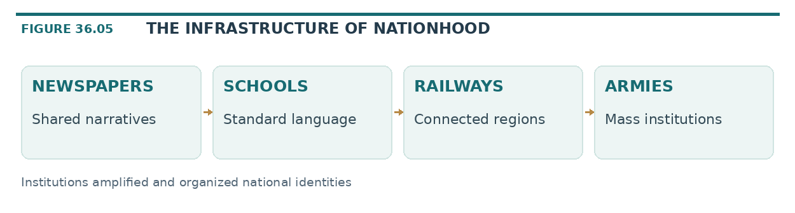

Националните движения станаха по-влиятелни, когато можеха да достигнат до непознати. Разширяване на грамотността, вестници, евтини печатни издания, пощенски системи, железници и доброволчески общества направиха далечните политически събития да се чувстват свързани. Един читател на провинциален вестник може да научи, че хората в други градове разисквали същата реформа или празнували същия герой. Споделени календари, символи и обществени церемонии създават повторение в пространството. Андерсън "принтирай капитализма" улавя една важна част от този процес, без да предполага, че всеки вестникар става националист. \[<a href="/036-nationalism-and-the-nineteenth-century-nation-state/sources/#source-2" class="cite">2</a>\]

Образованието имаше значение поне толкова. Училищата въвеждат стандартизиран правопис, национални истории, официална география и граждански задължения. Учителите могат да въвлекат правителствената версия на нацията в общностите, където обикновеният разговор използва друг език. Военната служба и по-късната масова избирателна политика изложиха хората на национални институции, но ефектът не беше еднакъв: селяните можеха да устоят на училищната учебна програма, докато все още се присъединяваха към армията, или да подкрепят регионалната автономия при спазване на държавните закони. \[<a href="/036-nationalism-and-the-nineteenth-century-nation-state/sources/#source-10" class="cite">10</a>\]

<figure class="figure" id="figure-36-5">

<figcaption>Фигура 36.5. Институциите увеличават и организират националната идентичност. <a class="figure-anchor" href="#figure-36-5" aria-label="Link to this figure">#</a></figcaption>
</figure>

Трябва да се прави разграничение между националните училища, управлявани от съществуващите държави, и нелегалните или доброволните училища, управлявани от движения, търсещи държавност. Първият често е имал за цел да превърне поданиците в граждани на една установена страна; вторият може да се опита да направи политическа нация видима преди независимостта. И двете показват, че национализмът не е бил просто емоция: нуждаел се е от организации, пари, учебни програми, социални мрежи и достъп до власт.
