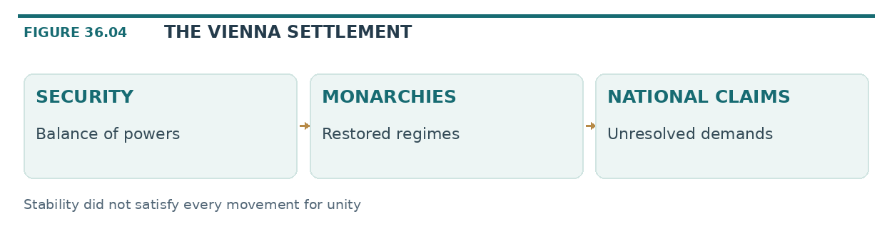

Поражението на Наполеон доведе до Конгреса на Виена през 1814 и 1815. Европейски дипломати потърсиха работещ баланс сред великите сили и се опитаха да сложат още един революционен или експанзионистичен катаклизъм. Те възстановиха и пренаредиха династични правителства, но също така направиха прагматични промени, които не можаха да пресъздадат точно по-ранната Европа. Новата немска конфедерация свърза десетки държави, говорещи немски и смесени езици, без да формира нито една суверенна Германия. Много италиански територии останаха разделени сред монархиите и под австрийско влияние. Територията на Полша продължава да се управлява до голяма степен от Русия, Прусия и Австрия, въпреки че детайлите на администрацията варират. \[<a href="/036-nationalism-and-the-nineteenth-century-nation-state/sources/#source-8" class="cite">8</a>\]

Селището във Виена не беше пълен отказ за реформа. Конституциите съществуваха или по-късно бяха въведени в някои държави, правителствата разшириха своите бюрократи и полицейското наблюдение съществуваше съвместно с разширяване на университетите и търговията. Проблемът за националните активисти беше, че дипломатическата легитимност като цяло се основаваше на признати владетели и договори, а не на принцип, който всяка самоописана нация трябва да управлява сама.

<figure class="figure" id="figure-36-4">

<figcaption>Фигура 36.4. Стабилността не удовлетворява всяко движение за единство. <a class="figure-anchor" href="#figure-36-4" aria-label="Link to this figure">#</a></figcaption>
</figure>

Да разгледаме три групи, които наблюдават едно и също споразумение. Един хабсбургски служител може да похвали сигурността след опустошителни войни. Един италиански студент може да възрази срещу чужди армии и политическа разпокъсаност. Полският патриот може да възприема разделението на историческа политическа общност като несправедливост. Международната дипломация може да стабилизира междудържавните отношения, като оставя националните стремежи недоволни. \[<a href="/036-nationalism-and-the-nineteenth-century-nation-state/sources/#source-8" class="cite">8</a>\]
