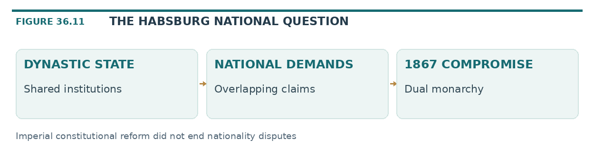

В земите на Хабсбург са включени немски говорители, унгарци, чехи, словаци, поляци, рутени/украинианци, хървати, хървати, словенци, румънци, италианци, сърби и др. Религиозни, регионални и социални различия прекосиха езиковите граници. Империята имаше традиции на династичната лоялност, бюрократичната интеграция, елитните преговори и икономическата взаимозависимост. Някои поданици търсеха независимост, други предпочитаха конституционната автономия в монархията. Исторически разказ, който предполага, че всеки е искал суверенна етническа държава от самото начало, пропуска голяма част от периода. \[<a href="/036-nationalism-and-the-nineteenth-century-nation-state/sources/#source-17" class="cite">17</a>\]\[<a href="/036-nationalism-and-the-nineteenth-century-nation-state/sources/#source-18" class="cite">18</a>\]

Революцията на 1848 разкрива тези конкурентни планове. Унгарските лидери потърсиха политическа автономия или независимост от Виена, но се сблъскаха с стремежите на немагиатското население в земите, за които твърди унгарската корона. Чешки активисти дискутираха федерални или национални права, без да се съгласят на усвояване в германска нация. Хърватски и други участници се договориха с Виена, унгарските лидери и съседните движения. Националният въпрос стана труден отчасти, защото няколко народи твърдеха, че застъпват територии.

<figure class="figure" id="figure-36-11">

<figcaption>Фигура 36.11. Имперската конституционна реформа не сложи край на споровете за националност. <a class="figure-anchor" href="#figure-36-11" aria-label="Link to this figure">#</a></figcaption>
</figure>

След военно поражение от Прусия през 1866 г., Хабсбургският режим прави Австро-Унгарския компромис от 1867 г., създавайки двойна монархия с отделни австрийски и унгарски правителствени структури под един монарх и общи институции за определени дела. Заселването повиши унгарските политически елити, но остави много други национални искания нерешени. В австрийската половина конституционните права на езика и сложната провинциална политика позволиха някои места за настаняване. През унгарската половина езикът и административната политика на магияр бяха спорни. Нито едната половина не беше просто статичен затвор на нации. \[<a href="/036-nationalism-and-the-nineteenth-century-nation-state/sources/#source-17" class="cite">17</a>\]\[<a href="/036-nationalism-and-the-nineteenth-century-nation-state/sources/#source-19" class="cite">19</a>\]
