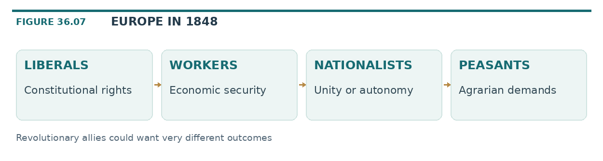

През 1848 г. в Европа избухнаха революции на фона на икономически затруднения, искания за конституции, враждебност към консервативни правителства и националистически амбиции. Във Франция падна юлската монархия и се създаде република. В германските страни либералните конгреси и публичните демонстрации настояваха за реформа и единство. В хабсбургската монархия революционерите оспорвали императорската администрация, докато чехи, унгарци, италианци, хървати и други напреднали отчасти конкуриращи се искания. \[<a href="/036-nationalism-and-the-nineteenth-century-nation-state/sources/#source-11" class="cite">11</a>\]

Въстанията не бяха една координирана революция. Градските работници се страхуваха от безработица, професионалистите искаха конституционни гаранции, селяните често се фокусираха върху феодални задължения и задължения за земя, а националните активисти оспорваха границите и езиковите права. Търсенето на национално освобождение от една общност може да алармира друга общност, живееща в същия регион. Хабсбургските власти използваха някои от тези разделения, но конфликтите също се кореняха в истински разногласия относно представителство и политическо оцеляване.

<figure class="figure" id="figure-36-7">

<figcaption>Фигура 36.7. Революционните съюзници биха искали много различни резултати. <a class="figure-anchor" href="#figure-36-7" aria-label="Link to this figure">#</a></figcaption>
</figure>

Много революции са били победени или контролирани от 1849. Въпреки това очевидният им провал крие дългосрочни последици: премахването на много останали селски задължения в Хабсбургските земи, опитът с представителни институции, публичната националистическа мобилизация и трайните символични спомени. Историците не бива да се съмняват в смазаното въстание, че то не променя нищо. Нейните участници може да са загубили контрол върху правителството, докато променят езика на легитимността.
