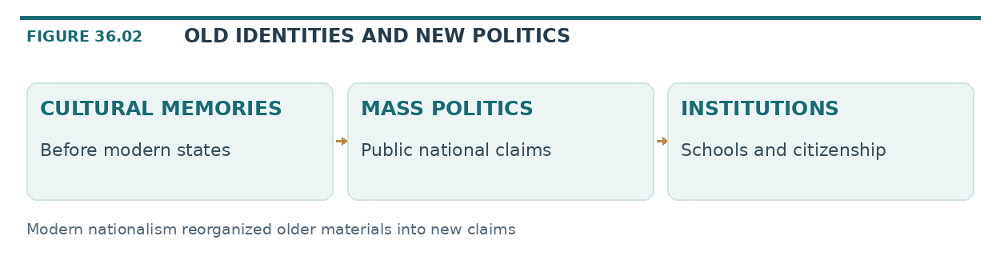

Хората отдавна говорели езици, почитали се в споделени традиции, помнили войните и признавали колективни имена. Претенции на английски, френски, полски, гръцки или китайски принадлежи преди индустриалното общество. Деветнадесети век не е изобретил всяка историческа общност от нищото. Това, което коренно се промени, беше политическата идея, че една нация трябва да бъде основен източник на суверенитет и че държавата трябва да учи гражданите да разпознават една споделена национална история. Учените не са съгласни с това колко приемственост разделя по-старите лоялност от съвременния масов национализъм. \[<a href="/036-nationalism-and-the-nineteenth-century-nation-state/sources/#source-1" class="cite">1</a>\]\[<a href="/036-nationalism-and-the-nineteenth-century-nation-state/sources/#source-4" class="cite">4</a>\]

Бенедикт Андерсън подчерта общности, представяни от хора, които никога няма да се срещнат с повечето си колеги. Ерик Хобсбоум изследва съвременните политически приложения на националната история и изобретява или променя традициите. Мирослав Хроч изследва как културните изследвания, патриотичната възбуда и по-широката политическа мобилизация взаимодействат сред по-малките европейски нации. Тези подходи осветяват механизмите; нито едно от тях не означава, че националните чувства са непременно фалшиви. Фактът, че настоящето на фестивала е скорошно, не доказва, че участниците в него изпитват неискрено. \[<a href="/036-nationalism-and-the-nineteenth-century-nation-state/sources/#source-2" class="cite">2</a>\]\[<a href="/036-nationalism-and-the-nineteenth-century-nation-state/sources/#source-5" class="cite">5</a>\]\[<a href="/036-nationalism-and-the-nineteenth-century-nation-state/sources/#source-6" class="cite">6</a>\]

<figure class="figure" id="figure-36-2">

<figcaption>Фигура 36.2. Съвременният национализъм реорганизира по-старите материали в нови твърдения. <a class="figure-anchor" href="#figure-36-2" aria-label="Link to this figure">#</a></figcaption>
</figure>

Историческият език има значение тук. Писател през 1800 може да нарече хората "нация," без да изисква независима държавност. Един селянин може да опише едно място, религия и монарх, а не модерен статут на гражданство. Етническите етикети на картата понякога отразяват класификацията на картографа, а не самоличността, която хората използват. Историкът трябва да попита кой е използвал самоличност, на каква аудитория и с какви политически последици.
