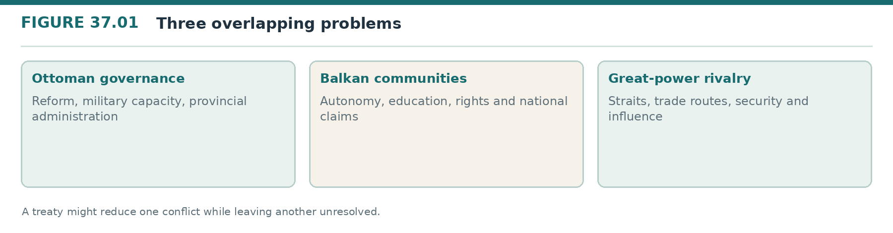

Преди да изследваме националните движения, премахнете въображаемата празнота от картата. Османска Югоизточна Европа съдържа села на самоусъвършенстващи се и пасторалисти, пристанища и пазарни градове, манастири, джамии, църкви, синагоги, училища, занаятчийски гилди и търговски мрежи. Православните християни формирали важни общности, но така правели мюсюлманите, католиците, евреите и хората с различен регионален и лингвистичен произход. Албанците включваха мюсюлмани и християни; славянско-говорящото население също се различаваше от религията и политическата лоялност. Един град може да бъде многоезичен в търговията, дори когато едно село е по-лингвистично хомогенно.

Отомански служители работиха чрез микс от централно назначени офицери, бирници, съдилища, религиозни органи, военни институции и местни елити. Те не бяха еднакво ефективни навсякъде. Терминът просо често се използва небрежно, за да се намекнат фиксирани национални общности, но османската уредба организира религиозна и правна власт по начини, които се променят с течение на времето; те не са еквивалентни на съвременните етнически народи. Местната идентичност може да бъде изразена чрез изповед, село, окупация, семейство, език или привързаност към династия, а не само една национална категория.

Това има значение при четене на карти, произведени след 1850. Картограф може да определи същия смесен район на "гръцки," "български," "сръбски" или "албански" район в зависимост от това дали езикът, църковната вярност, училищното присъствие или политическите предпочитания са били третирани като решаващи. Нито един от тези показатели не е идеален заместител за другите. Националните движения не измислят местни традиции, но ги реорганизират в твърдения, че отделни хора трябва да имат държава. \[<a href="/037-the-balkans-and-the-eastern-question/sources/#source-3" class="cite">3</a>\]\[<a href="/037-the-balkans-and-the-eastern-question/sources/#source-4" class="cite">4</a>\]

<figure class="figure" id="figure-37-1">

<figcaption>Фигура 37.1. Политическите проблеми се припокриват, а не се появяват в една проста последователност. <a class="figure-anchor" href="#figure-37-1" aria-label="Link to this figure">#</a></figcaption>
</figure>
