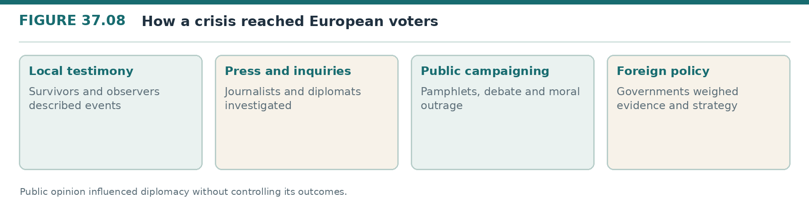

Българските революционни комисии планирали въстание през 1876 г. Априлското въстание избухна в няколко области, въпреки че участието, военната подготовка и резултатите варираха широко. Османските сили и нередовните войски я потулиха с изключително насилие, включително убийството на цивилни. Батак стана един от най-известните места за зверство. Страданието галванизира българската национална памет и предизвика международно разследване и протест.

Сметките на общите жертви и описанията на конкретни инциденти трябва да се обработват внимателно. Съвременните журналисти, дипломати, оцелели и по-късно национални историци не са писали с едни и същи цели или достъп до информация. Отговорната глава не намалява документираното масово насилие, тъй като цифрите се различават и не повтарят всяко драматично число според установения факт. Открояване на появата на зверства, които са силно подкрепени от точни демографски твърдения, които изискват отделна проверка.

Също така има етично задължение да се включат обикновените хора, чиито преживявания изчезват, когато историята стане само конкуренция между народите. Българските цивилни също пострадаха от терор и разрушение; мюсюлманските граждани в по-широкия цикъл на война и отмъщение, а по-късните движения на населението засегнаха и двете групи. Разпознаването на повече от една жертва не замъглява извършителите. \[<a href="/037-the-balkans-and-the-eastern-question/sources/#source-14" class="cite">14</a>\]\[<a href="/037-the-balkans-and-the-eastern-question/sources/#source-22" class="cite">22</a>\]

<figure class="figure" id="figure-37-8">

<figcaption>Фигура 37.8. Разследване, публичност и дипломация взаимодействат по време на кризата през 1876 г. <a class="figure-anchor" href="#figure-37-8" aria-label="Link to this figure">#</a></figcaption>
</figure>
