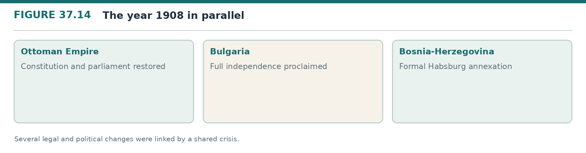

Договорът от Берлин упълномощи Австрия-Унгария да окупира и управлява Босна и Херцеговина през 1878 г., въпреки че територията официално остава под османския суверенитет. Военната окупация срещна съпротива, включително сред мюсюлманите и други, които се противопоставиха на намесата на Хабсбург. Последвалата администрация реорганизира части от провинциалната бюрокрация, транспорта, полицията, образованието и финансите, като същевременно направлява напрежението сред мюсюлманските, православните и католическите общности.

Представители на Хабсбург се надяваха, че територията ще бъде управлявана, без просто да се превърне в платформа за сръбски или хърватски национални проекти. Техните политики включваха опити за култивиране на по-широка босненска териториална идентичност, но предаността на населението оставаше оспорвана. Човек може да идентифицира съществени подобрения на инфраструктурата, без да заключи, че окупацията е доброволна или законна в очите на всеки жител. Също така националистическата опозиция не трябва да се третира като единодушна във всички групи.

През 1908 г. Австрия-Унгария официално се присъедини към Босна и Херцеговина, което предизвика тежка дипломатическа криза. Сърбия протестира; Русия беше отслабена след Руско-японската война и революцията от 1905 г.; Германия подкрепи своя съюзник Австрия-Унгария. Кризата беше решена без европейска война, но това влоши недоверието. През 1914 г. управлението на Сараево по време на Хабсбург става създаването на убийство, което предизвиква много по-широк неподчинение. \[<a href="/037-the-balkans-and-the-eastern-question/sources/#source-2" class="cite">2</a>\]\[<a href="/037-the-balkans-and-the-eastern-question/sources/#source-21" class="cite">21</a>\]

<figure class="figure" id="figure-37-14">

<figcaption>Фигура 37.14. Политическите трансформации от 1908 г. са свързани помежду си. <a class="figure-anchor" href="#figure-37-14" aria-label="Link to this figure">#</a></figcaption>
</figure>
