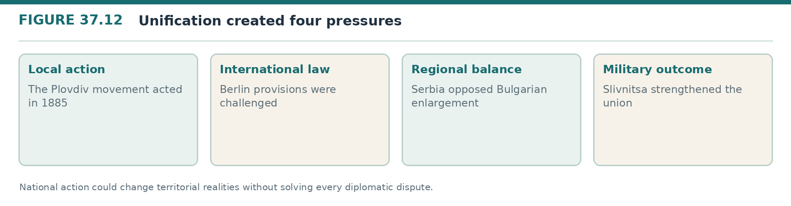

Източна Румелия, със своя административен център в Пловдив, официално е автономна османска провинция под ръководството на християнски генерал-губернатор. Нейните институции и училища създадоха политическа обстановка, различна от османските провинции, оставени под по-директно централно управление. Българските активисти преследваха съюз със северното княжество, докато властите и чуждите сили дискутираха как Берлинското селище ще бъде подкрепено.

През септември 1885 г. едно движение в Пловдив разруши провинциалното правителство и обяви съюз с българското княжество. Принц Александър прие съюза. В резултат на това кризата показа, че уреждането на 1878 г. не е постоянно само защото великите сили са го подписали. Османските и европейските реакции бяха обусловени от опасността от по-широка война и от конкурентни изчисления. В случай на дипломатическо настаняване признава новата реалност, без първоначално изтриване на всяка правна измислица на по-стария ред.

В българската обществена памет обединението често се появява като момент на смели национални действия и с основание. Но тя трябва да бъде проучена и като случай на конституционна промяна и дипломатическа импровизация. Какви бяха правните разходи за нарушаване на международен договор? Какво дало на профсъюза популярен авторитет? Как съседните държави оценили прецедента? Същите действия могат да се отпразнуват като самоопределение от една нация и се страхуват като дестабилизиране от друга. \[<a href="/037-the-balkans-and-the-eastern-question/sources/#source-1" class="cite">1</a>\]\[<a href="/037-the-balkans-and-the-eastern-question/sources/#source-29" class="cite">29</a>\]

<figure class="figure" id="figure-37-12">

<figcaption>Фигура 37.12. Обединяването на 1885 г. промени фактите на място и регионалната дипломация. <a class="figure-anchor" href="#figure-37-12" aria-label="Link to this figure">#</a></figcaption>
</figure>
