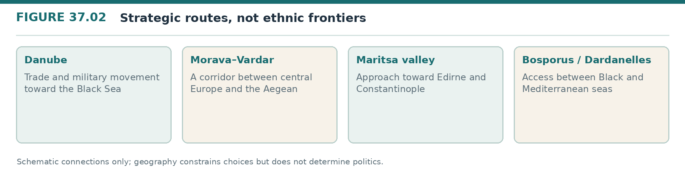

Балканите бяха стратегически важни отчасти, защото географията ограничи движението. Дунав свързва европейския интериор с Черно море и осигурява маршрут за зърно, търговия и армии. Планинските горнища, включително Стара планина, Родопите, Динарските вериги и Пиндукс създадоха местни бариери, докато конкретни проходи станаха точки от военно значение. Коридорът Морава го свързва с Централна Европа към Солун; долината Марица предлага друг път към Одрин и Константинопол. Адриатическо, Егейско и Черно море отвориха различни морски посоки.

За Русия, черноморския достъп и Босфора и Дарданелите имат последици за военноморското и търговско движение. За Великобритания една потенциално доминираща руска позиция близо до източното Средиземноморие породи опасения за военноморската стратегия и маршрути към Индия, особено след откриването на Суецкия канал през 1869 г. Австро-Унгария изследва маршрутите към Босна, Адриатическо и Централнобалканско интериор; перспективата за националистическа възбуда сред своите южни славяни засили изчисленията му. Италия също така разви интересите на Адриатическо море след обединението.

Географията не диктува автоматично политиката. Същото пристанище може да бъде търговска възможност за търговците и стратегическа уязвимост за дипломатите. Ето защо карта на планини и проливи ни помага да определим ограничения, а не предварително определени резултати. Винаги питай кой контролира прохода, кой всъщност живее до него и кой може да достави войските, предназначени да го задържат. \[<a href="/037-the-balkans-and-the-eastern-question/sources/#source-2" class="cite">2</a>\]\[<a href="/037-the-balkans-and-the-eastern-question/sources/#source-5" class="cite">5</a>\]

<figure class="figure" id="figure-37-2">

<figcaption>Фигура 37.2. Водните пътища и коридорите създадоха стратегически връзки, а не естествени национални граници. <a class="figure-anchor" href="#figure-37-2" aria-label="Link to this figure">#</a></figcaption>
</figure>
