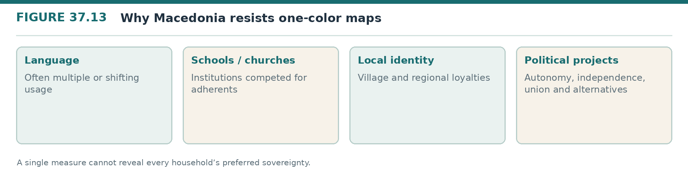

Османска Македония не беше една модерна държава с всеобщо приета граница. Историците използват термина за широк географски и исторически район, докато османските административни райони не съвпадат с всяка по-късна национална карта. Градове, планини и долини съдържаха популации, които се различаваха от езика, религията, училището и църковната принадлежност, местната лоялност и политическите стремежи. Евреите бяха значителна част от градското общество на Солунка; мюсюлманите включваха турско-, албанско-, славянско- и други говорещи общности; православните християни можеха да имат конкурентни институционални привързаности.

Българските, гръцките и сръбските национални движения създадоха училища, църкви, вестници, въоръжени групи и дипломатически кампании, които търсеха влияние. Екзархист и Патриархизъм конкуренция понякога се превръща в индекс на националната вярност, но тя не превръща всяко домакинство в фиксирана национална категория. Някои активисти подкрепяха автономията или федерацията; други насърчаваха съюза със съседните държави. Вътрешната македонска революционна организация и свързаните с нея мрежи се промениха с течение на времето и техните цели и членове не трябва да бъдат изравнявани в една непрекъсната програма.

Съвременните български, гръцки и северномакедонски национални разкази често придават различни значения на индивидите и движенията от деветнадесети век. В внимателната история се посочва какво е казал човек в даден документ, когато е бил написан и кои самоличности са били налични в този контекст. Тя избягва с обратно действие да използва категорията на преброяване от 21 век като доказателство за това как цялото село от 19-ти век е разбрало себе си. \[<a href="/037-the-balkans-and-the-eastern-question/sources/#source-4" class="cite">4</a>\]\[<a href="/037-the-balkans-and-the-eastern-question/sources/#source-30" class="cite">30</a>\]

<figure class="figure" id="figure-37-13">

<figcaption>Фигура 37.13. Нито един демографски показател не улавя сложността на Македония. <a class="figure-anchor" href="#figure-37-13" aria-label="Link to this figure">#</a></figcaption>
</figure>
