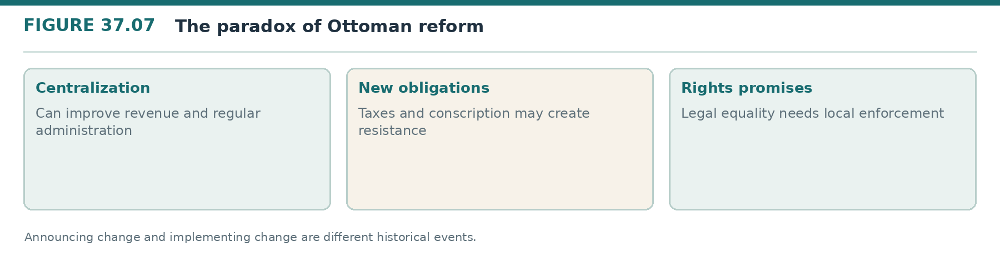

Реформите Tanzimat, традиционно датирани от 1839 до 1876 г., се опитват да подобрят администрацията, да реорганизират военните и фискалните институции и да предефинират правния статут на темите. Реформните декрети и новите закони обещаваха форми на сигурност и равенство, които бяха значителни отклонения от по-старите договорености. Centralization, провинциални съвети, стандартизирани регулации, нови училища и подобрени комуникации разшириха капацитета на държавата неравномерно.

Реформата може да създаде ново напрежение. Мюсюлманските общности понякога се страхували да не загубят установени предимства, докато християнските поданици можели да приветстват законовите обещания, но да останат скептични, когато властите не успели да ги изпълнят. Местните елити се съпротивляваха на мерки, които заплашваха властта им. Способността на едно османско правителство да обяви равенство надхвърлила капацитета му да налага равно третиране във всяко село. Нещо повече, разширени абонамент, нови данъци и по-силна полиция може да се чувстват по-малко като освобождение, отколкото нахлуване.

През 1876 г. политиците с реформаторско мислене помогнаха да се въведе първата османска конституция и парламент, което е тясно свързано с кризата през тази година. Султан Абдулхамид II е напуснал парламента през 1878 г. Тази последователност показва, че конституционната политика и оцеляването на императора са преплетени. Османската история не просто е преминала от непроменен деспотизъм към колапс; тя съдържала значителни програми за реформи, чиито цели и последствия били оспорени. \[<a href="/037-the-balkans-and-the-eastern-question/sources/#source-3" class="cite">3</a>\]\[<a href="/037-the-balkans-and-the-eastern-question/sources/#source-7" class="cite">7</a>\]

<figure class="figure" id="figure-37-7">

<figcaption>Фигура 37.7. Османската реформа създаде нови възможности и ново напрежение. <a class="figure-anchor" href="#figure-37-7" aria-label="Link to this figure">#</a></figcaption>
</figure>
