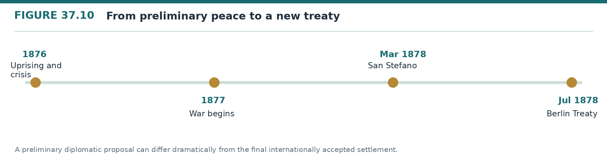

Предварителният договор от Сан Стефано, подписан на 3 март 1878 г. в съвременния Грегориански календар, предлага голямо автономно българско княжество под османското сюзераинти, с територия, простираща се в части на Македония и Тракия. Прогнозираната география е централна за по-късно българското национално въображение. Споразумението следваше военната победа, но това не беше всеобщо приет окончателен мир. Неговите условия се отнасяха и до Сърбия, Черна гора, Румъния и руската териториална печалба.

Изключително аналитично разграничение: прогнозираните граници на Сан Стефано бяха дипломатически дизайн, а не извършено преброяване на националните предпочитания. В рамките на предвиденото княжество живееха хора с различни езици, религии и политически връзки. Някои жители приветстваха една българска държава; други се бояха от новата договореност или от други политически фючърси. Следователно линиите не следва да бъдат представяни като доказателство, че всяко споразумение в рамките на тях принадлежи културно или политически към една нация.

Великобритания и Австрия-Унгария се опасяват, че разширена българска държава може да се превърне в инструмент на руското влияние, застрашавайки регионалния баланс на властта. Русия също трябваше да обмисли риска от по-широк конфликт с други европейски държави. Поради тези причини споразумението беше преразгледано на конгреса в Берлин. Пролуката между проектната карта на Сан Стефано и последвалия договор се превърна в траен източник на българско недоволство, често обобщаван в националния спомен като разделението на българските земи. \[<a href="/037-the-balkans-and-the-eastern-question/sources/#source-1" class="cite">1</a>\]\[<a href="/037-the-balkans-and-the-eastern-question/sources/#source-26" class="cite">26</a>\]

<figure class="figure" id="figure-37-10">

<figcaption>Фигура 37.10. Сан Стефано и Берлин отбелязаха различни етапи от една дипломатическа криза. <a class="figure-anchor" href="#figure-37-10" aria-label="Link to this figure">#</a></figcaption>
</figure>
