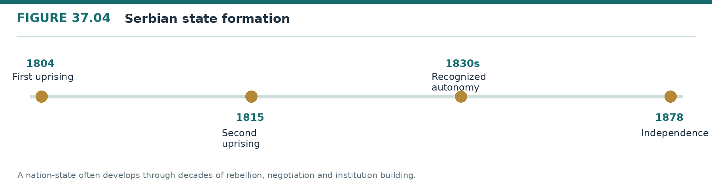

Първото сръбско въстание започва през 1804 г. срещу местните злоупотреби с яничарството и се превръща в по-широко предизвикателство пред османското управление. Караоор става виден лидер. През 1813 г. едно османско разузнаване прекъснало движението, но второ въстание през 1815 г., свързано с Милош Обренович, открило по-траен път към самоуправлението. Чрез преговори, местна политическа консолидация и промени в международния баланс сръбското княжество придобива все по-голяма автономия през 1820 г. и 1830 г. Пълната му независимост е международно призната в Берлин през 1878 г.

Траекторията показва, че националната независимост може да бъде дълга серия от договорености, а не една победоносна битка. Сръбските владетели се съревноваваха помежду си, изграждаха съдилища и училища, търсеха данъчно облагане и военен капацитет и оспорваха конституционните ограничения на династичната власт. Сърбия поддържа също претенции и симпатии отвъд съществуващата си граница - факт, който по-късно ще повлияе на отношенията с Османските провинции и Австро-Унгария.

Сръбската история не може да бъде разбрана, като третира всеки православен славянски говорител като безспорен член на една политическа нация. Идентичностите и лоялността варираха, особено в Босна, Косово и Македония. Полезно сравнение с Гърция и България е степента, до която всяко движение съчетава селски бунт, религиозни институции, външна интервенция и евентуално държавно строителство. \[<a href="/037-the-balkans-and-the-eastern-question/sources/#source-8" class="cite">8</a>\]\[<a href="/037-the-balkans-and-the-eastern-question/sources/#source-9" class="cite">9</a>\]

<figure class="figure" id="figure-37-4">

<figcaption>Фигура 37.4. Автономността и международно признатата независимост бяха различни етапи. <a class="figure-anchor" href="#figure-37-4" aria-label="Link to this figure">#</a></figcaption>
</figure>
