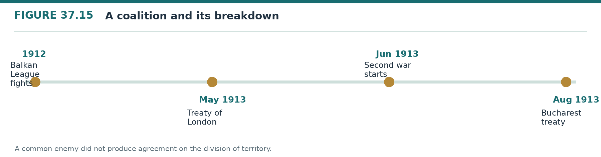

До 1912 г. Османската империя е изправена пред италиански военни действия в Либия, албански размирици и постоянно напрежение в европейските си провинции. България, Сърбия, Гърция и Черна гора формираха Балканската лига чрез свързани споразумения и атакуваха Османската империя през есента на 1912 г. Тяхната коалиция беше ефективна срещу османските сили, въпреки че съюзниците преследваха цели, които не бяха напълно съвместими. Българските армии водят големи кампании в Тракия, сръбските сили напредват в Македония, а гръцките сили превземат Солун. Черна гора се биеше на запад.

Първата Балканска война драстично намали отоманския териториален контрол в Европа. Мирните преговори създадоха Договора от Лондон през май 1913 г., но съюзниците все още оспорват как трябва да бъде разпределена територията. Военната окупация не урежда автоматично правния суверенитет или популярното съгласие. Всяко правителство може да твърди, че неговите жертви, договори или национална история оправдават определени територии. Македония и достъпът до Егейско море бяха особено оспорени.

Не разказвай тази война само като освобождението на християните от империя. Много жители са преживели военно насилие и изселване; мюсюлманските цивилни бяха особено уязвими в няколко театъра, докато някои християнски общности приветстваха приближаващите войски, а други се опасяваха от нова администрация. Късият живот на Алианса показва как коалиция, обединена от общ враг, може да се разпадне, след като победата изисква разделяне на печалбите. \[<a href="/037-the-balkans-and-the-eastern-question/sources/#source-4" class="cite">4</a>\]\[<a href="/037-the-balkans-and-the-eastern-question/sources/#source-31" class="cite">31</a>\]

<figure class="figure" id="figure-37-15">

<figcaption>Фигура 37.15. Победата над общ враг не урежда териториални разногласия. <a class="figure-anchor" href="#figure-37-15" aria-label="Link to this figure">#</a></figcaption>
</figure>
