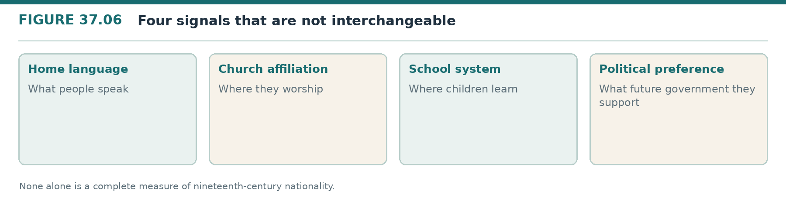

Едно централно българско искане се отнасяше до способността за поклонение и образование под българска църковна йерархия, а не до гръцко-говорещите институции на Вселенската патриаршия. Султански указ през 1870 г. създава Българската екзархия. Нейната юрисдикция включваше правила за конкретни епархии и, при определени условия, местни преференции. Въпросът не беше само богословски: училища, назначения, поклонение език, общи ресурси и символично представителство са били изложени на риск.

В някои области принадлежността към църквата се превърна в показател, използван от националните комисии и външни лица за класифициране на населението. Конкуренцията между екзархитейните и патриаршните институции може да изрази български и гръцки политически проекти, особено в спорни области. Патриаршията не представлява всеки гръцкоговорящ човек по един и същ политически начин, а екзархията не е перфектно преброяване на българската националност. Религиозните разделения могат също така да засилят съперничеството си с училищата, църквите и земята.

Екзархията е най-добре разбрана както като културна институция, така и като политически ресурс. Той помогна за създаването на пространство за образование и администрация, преди да е съществувала българска държава, но работи и в рамките на османските структури и се изправи пред дилеми след като селището от 1878 г. раздели териториите, свързани с българските национални стремежи. \[<a href="/037-the-balkans-and-the-eastern-question/sources/#source-13" class="cite">13</a>\]\[<a href="/037-the-balkans-and-the-eastern-question/sources/#source-15" class="cite">15</a>\]

<figure class="figure" id="figure-37-6">

<figcaption>Фигура 37.6. Институциите и езикът не трябва да се бъркат с пълно етническо преброяване. <a class="figure-anchor" href="#figure-37-6" aria-label="Link to this figure">#</a></figcaption>
</figure>
