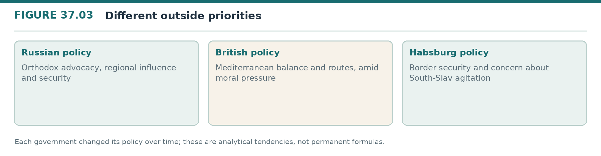

Русия комбинира няколко мотива: стратегически интереси в Черно море и пролива, съперничество с други империи, симпатия към православните християнски общности и вътрешно Пан-Слав настроения, чието влияние варираше по период. Той не е бил просто алтруистичен защитник, нито сила, чието действие е било reducable за топло-водни пристанища. Великобритания често ценяла запазването на работеща османска държава като бариера за дестабилизиране на разширяването, но британските отговори също били изместени под натиск от съобщенията за насилие и хуманитарна възбуда. Франция, Австрия-Унгария и Германия имаха свои собствени променящи се интереси; германският канцлер Бисмарк се опита да управлява европейските отношения, като същевременно избягваше голям конфликт, който би могъл да застраши новата му империя.

Езикът на "Концерт на Европа" описва навиците на консултации с голяма сила, които се развиват след Наполеон. Концертната дипломация помогна за справянето с някои кризи, но участващите държави бяха неравностойни, а на по-малките народи рядко им беше дадена сравнима власт в преговорите. Великите сили не са съгласни с това, което се счита за легитимно национално самоопределение или приемливо преразпределение на властта. Поради това сътрудничеството им беше условно.

Един полезен метод е да се разделят публично обявените принципи от изборите на място. Един държавник може да подкрепи религиозната свобода, докато подкрепя военната окупация; друг може да похвали националното освобождение, докато търси клиентско правителство. Политическите мотиви често се смесвали. Политиката може да бъде едновременно стратегическа, идеологическа, икономическа и да отговаря на общественото мнение. \[<a href="/037-the-balkans-and-the-eastern-question/sources/#source-2" class="cite">2</a>\]\[<a href="/037-the-balkans-and-the-eastern-question/sources/#source-6" class="cite">6</a>\]

<figure class="figure" id="figure-37-3">

<figcaption>Фигура 37.3. Приоритетите на великите сили се променят с течение на времето и могат да бъдат вътрешно противоречиви. <a class="figure-anchor" href="#figure-37-3" aria-label="Link to this figure">#</a></figcaption>
</figure>
