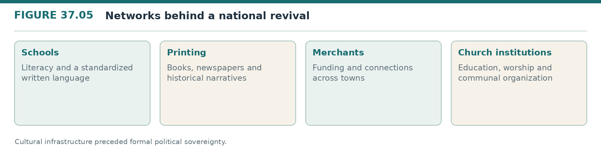

Валахия и Молдавия се радваха на отличителни институции под османската сюзеренти, оформени също от руското влияние и периодичните чуждестранни професии. Техните лидери и интелектуалци са участвали в революционната политика от 1848 г., въпреки че тези движения са били потиснати. След Кримската война дипломатическите договорености отвориха пътя към съюза. През 1859 г. и двете княжества избират Александру Йоан Куза, създавайки фактически политически съюз, който впоследствие е консолидиран. Държавата прие името Румъния с конституционни промени и в крайна сметка монархия под управлението на Карол I.

Дунавът имаше значение както икономически, така и политически. Износът на зърно, правилата за навигация, митниците, пристанищата и речните комисии включваха както румънски политици, така и съседни сили. Румъния се е борила редом с Русия през 1877-1878 г. и е била призната за независима от Берлинския договор. Въпреки това териториалното му селище беше сложно: южна Бесарабия премина в Русия, а Румъния получи северна Добруджа. Уговорките включваха местни общности, чиито политически предпочитания не съвпадаха добре с дипломатическия обмен.

Румънският случай предупреждава да не се описва националното обединение като изчезване на външната власт. Румънските лидери изградиха институции, докато маневрираха между Истанбул, Санкт Петербург, Виена и други столици. Независимостта също повдигна спорни въпроси относно малцинствата, собствеността, гражданството и включването. \[<a href="/037-the-balkans-and-the-eastern-question/sources/#source-11" class="cite">11</a>\]\[<a href="/037-the-balkans-and-the-eastern-question/sources/#source-12" class="cite">12</a>\]

<figure class="figure" id="figure-37-5">

<figcaption>Фигура 37.5. Културните мрежи помогнаха да се поддържат политически идеи преди съществуването на държава. <a class="figure-anchor" href="#figure-37-5" aria-label="Link to this figure">#</a></figcaption>
</figure>
