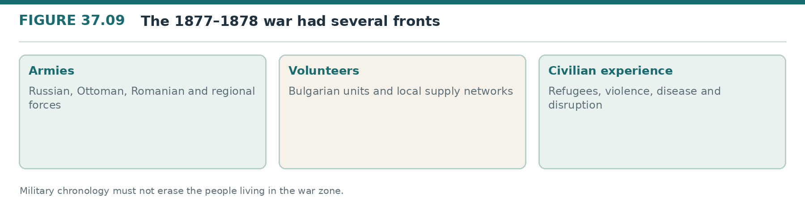

Руските сили прекосяват Дунав през 1877 г. и преминават през Северна България. Османската съпротива в Плевня (Плевен), водена от Осман паша, забави кампанията и наложи тежки жертви. Продължителна обсада успя само след по-нататъшни операции и ангажираността на съюзническите румънски сили. В Стара планина битките около прохода Шипка станаха важни както във военно, така и в българската историческа памет. Войната продължила през зимните операции, като в крайна сметка руските сили били близо до Константинопол.

Кампанията не беше просто движение на армии през празна територия. Войниците се нуждаеха от боеприпаси, храна, коне и маршрути, годни за артилерия; зимното време предизвика операции; цивилни избягаха да се бият или станаха изложени на репресии и болести. Български доброволци, често наричани опалченци, участваха заедно с руските сили. Кампаниите на Сърбия и Черна гора и румънското участие трябва да се считат за част от по-широката военна и дипломатическа обстановка, а не за една национална история за освобождение.

Насилието срещу цивилни включваше нападения срещу мюсюлманско население и разселване заедно с по-ранните репресии на българските християни. Историците отличават загубите от бойното поле, бежанците, принудителното експулсиране и цивилните смъртни случаи; тези категории не трябва да се сливат в една впечатляваща, но неподдържана фигура. За общностите в региона, освобождението, поражението, оцеляването и изгнанието могат да се случат в рамките на една и съща война, в зависимост от това къде живее едно семейство и каква политическа идентичност му е възложена. \[<a href="/037-the-balkans-and-the-eastern-question/sources/#source-24" class="cite">24</a>\]\[<a href="/037-the-balkans-and-the-eastern-question/sources/#source-25" class="cite">25</a>\]

<figure class="figure" id="figure-37-9">

<figcaption>Фигура 37.9. Войната беше изпитана и от войници, и от цивилни. <a class="figure-anchor" href="#figure-37-9" aria-label="Link to this figure">#</a></figcaption>
</figure>
