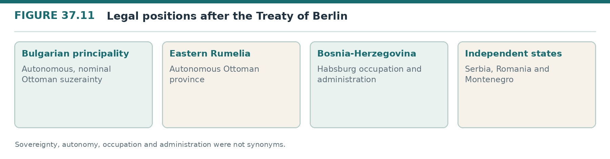

Договорът от Берлин е подписан на 13 юли 1878 г. Той намалява размера на българското княжество, прожектирано в Сан Стефано и разделя Източна Румелия, която е създадена като автономна провинция под политическия и военен авторитет на Османския султан. Македония и голяма част от Тракия останаха под по-директно турско управление. Сърбия, Черна гора и Румъния получиха международно признание за независимост с териториални корекции и условия, включващи права и имущество. Австро-Унгария получи правомощия да окупира и управлява Босна и Херцеговина, докато Османският суверенитет официално продължи. Великобритания организира отделно управление на Кипър съгласно Кипърската конвенция от 1878 г.

Договорът не сложи край на императорското припокриване. "Независими," "автономни," "заети," "приложени" и "под сузеренти" бяха различни правни позиции, с различни последици за данъчното облагане, външната политика и военните въпроси. Схема на уреждането следва да разграничава действителното правителство от формалните искове. България все още не е напълно независимо кралство през 1878 г.; Източна Румелия не е законно приложен към княжеството; Босна и Херцеговина не са официално приложени от Австрия-Унгария до 1908 г.

Договорът съдържал разпоредби, свързани с религиозната свобода и правата на жителите, но степента, до която те защитавали уязвимите общности, била неравномерна. Централното му постижение беше временно управление на съперничеството с голяма сила. Нейната централна слабост оставяше силните национални претенции недоволни, особено в Македония и съседните региони. \[<a href="/037-the-balkans-and-the-eastern-question/sources/#source-1" class="cite">1</a>\]\[<a href="/037-the-balkans-and-the-eastern-question/sources/#source-27" class="cite">27</a>\]

<figure class="figure" id="figure-37-11">

<figcaption>Фигура 37.11. Различните правни режими останаха на балканската карта след Берлин. <a class="figure-anchor" href="#figure-37-11" aria-label="Link to this figure">#</a></figcaption>
</figure>
