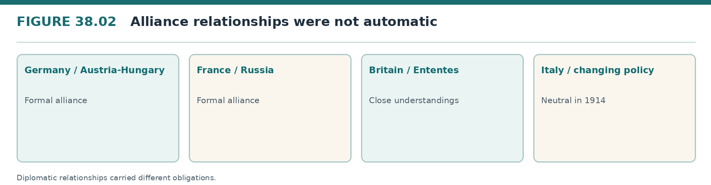

Предвоенното дипломатическо подравняване често се опростява в два твърди блока. Германия и Австрия-Унгария са свързани с един съюз, докато Франция и Русия имаше военен съюз. Великобритания развива по-близки отношения с Франция и Русия чрез Енте Кордиал и англо-руската конвенция, но те не са идентични с нито един договор, задължаващ Великобритания да отиде на война във всеки източноевропейски конфликт. Италия официално е принадлежала към Тройния алианс, но все още остава неутрална през 1914 г. и по-късно се бори срещу Австрия-Унгария. Османското и българското участие следва отделни изчисления през 1914 г. и 1915 г.

Съюзите са създадени отчасти, за да възпират атаката, но те могат да направят лидерите прекалено самоуверени или уплашени. Австро-Унгария може да смята, че германската подкрепа е намалила опасността да се изправи срещу Сърбия; Русия може да се страхува, че изоставянето на Сърбия ще съсипе регионалната й позиция. Германските организатори се страхуваха от двуфронтна война с Франция и Русия. Резултатът беше система, в която същото обещание, което успокояваше една държава, може да алармира друга. Алиансите не бяха релси, върху които влаковете неизбежно се движеха: те бяха политически отношения, тълкувани и действани от правителствата. \[<a href="/038-world-war-i-causes-and-consequences/sources/#source-2" class="cite">2</a>\]\[<a href="/038-world-war-i-causes-and-consequences/sources/#source-5" class="cite">5</a>\]

<figure class="figure" id="figure-38-2">

<figcaption>Фигура 38.2. Връзките с Алианса не бяха автоматични. <a class="figure-anchor" href="#figure-38-2" aria-label="Link to this figure">#</a></figcaption>
</figure>
