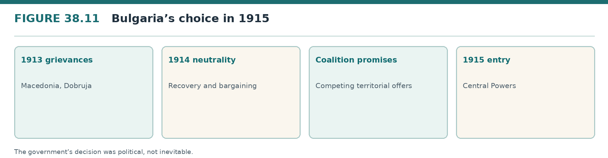

България навлиза в двадесети век след поредица от политически трансформации: селището от 1878 г., обединението през 1885 г., пълната независимост през 1908 г. и Балканските войни от 1912 год.1913 г. Втората балканска война остави България победена и недоволна от разделението на Македония и загубата на Южна Добруя в Румъния. Тези териториални оплаквания оформили дипломатическите преговори през 1914 и 1915 г., но те не определили автоматично избора на коалиция. Българските лидери знаеха, че държавата им е изтощена от скорошните боеве и първоначално запазиха неутралитет.

Противопоставените съюзи предлагали различни възможности. Централните сили могат да обещаят територия в Сърбия, особено Вардар Македония, докато Ентенте се изправи срещу конкурентните претенции на Сърбия, Гърция и Румъния, всеки от които има потенциал или реален партньор. Българското правителство, крал Фердинанд, военни лидери и политическа опозиция не формираха нито един безспорен глас. Правителството на премиера Васил Радославов в крайна сметка се присъедини към Германия и Австрия-Унгария. За да разберете това решение, отличете страданието и надеждите на населението от стратегическите изчисления, направени от владетелите, които посветили страната на война. \[<a href="/038-world-war-i-causes-and-consequences/sources/#source-25" class="cite">25</a>\]\[<a href="/038-world-war-i-causes-and-consequences/sources/#source-26" class="cite">26</a>\]

<figure class="figure" id="figure-38-11">

<figcaption>Фигура 38.11. Избор на България през 1915 г. <a class="figure-anchor" href="#figure-38-11" aria-label="Link to this figure">#</a></figcaption>
</figure>
