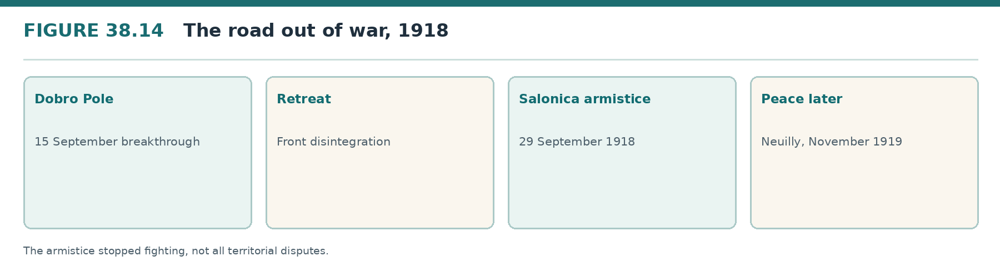

На 15 септември 1918 г. съюзнически сили, включително големи сръбски и френски формации, атакуваха позиции на македонския фронт в сектор "Добро поле." Те пробиха част от българската отбрана в труден терен. Разкъсването се превърна в по-широка криза, тъй като изтощените войски отстъпиха и командването се бореше да организира устойчива нова линия. Някои български единици другаде, особено в района на Дойран, се сражаваха ефективно, но местната съпротива не можа да обърне стратегическия колапс. Събитията бързо подкопават способността на правителството да продължи войната.

Отстъпващите войници се присъединиха към размириците, които допринесоха за въстанието на Радомир; политическата криза се ускори. България иска примирие, подписано в Солун на 29 септември 1918 г., което го прави първата Централна сила, която напуска войната. Крал Фердинанд абдикирал в началото на октомври в полза на Борис III. Примирието не урежда последните граници на България. Той прекрати военното си участие при съюзнически условия и започна трудна борба срещу политическата отговорност, затворниците, репарациите и мястото на страната в нов регионален ред. \[<a href="/038-world-war-i-causes-and-consequences/sources/#source-25" class="cite">25</a>\]\[<a href="/038-world-war-i-causes-and-consequences/sources/#source-29" class="cite">29</a>\]

<figure class="figure" id="figure-38-14">

<figcaption>Фигура 38.14. Пътят на войната, 1918 г. <a class="figure-anchor" href="#figure-38-14" aria-label="Link to this figure">#</a></figcaption>
</figure>
