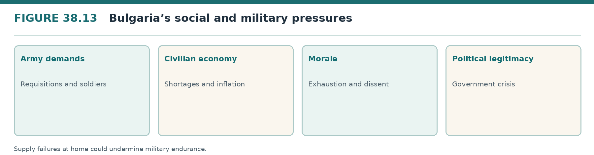

Българската военна мобилизация постави извънредно бреме върху сравнително малка държава. Военни реквизиции, инфлация, недостиг на работна ръка и отклоняване на селскостопански работници в армията обтегнати домакинства. Семействата в селските райони зависели от реколтата, докато се справяли с изчезналите хора, транспортните трудности и несигурния достъп до доставките. Войниците получиха доклади за трудности у дома; семействата очакваха заплащане, отпуск, новини и евентуално мир. Военното финансиране все повече оформяше вътрешната политика и способността на правителството да постигне военна победа стана централна за легитимността й.

Опозицията срещу войната не означава непременно подкрепа за враговете на България. Аграрен лидер Александър Стамболийски се противопостави на влизането в конфликта и беше хвърлен в затвора; други критикуваха правителството по различни причини. До 1918 г. изтощението било широко разпространено. Българският опит показва как военното изпълнение и политическото съгласие могат да се разклонят: войникът може ефективно да защитава позицията си, докато решава, че продължаващата война вече не служи на страната. Фискалният и социален капацитет на държавата не беше неограничен и всяка допълнителна кампания засили противоречието между националните цели и способността на населението да ги поддържа. \[<a href="/038-world-war-i-causes-and-consequences/sources/#source-25" class="cite">25</a>\]\[<a href="/038-world-war-i-causes-and-consequences/sources/#source-26" class="cite">26</a>\]

<figure class="figure" id="figure-38-13">

<figcaption>Фигура 38.13. Социален и военен натиск в България <a class="figure-anchor" href="#figure-38-13" aria-label="Link to this figure">#</a></figcaption>
</figure>
