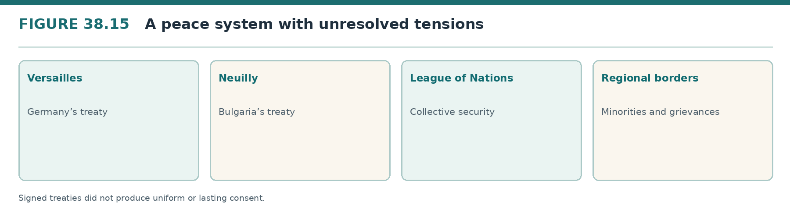

Мирната система включваше споразумения с Австрия в Сен Жермен, Унгария в Трианон, България в Ньойли и Османската империя в Севрес, макар че последното селище не беше реализирано така, както първоначално беше предвидено. Политическата и военната борба в Анадола доведе вместо това до Договора от Лозана през 1923 г., който признава суверенитета на Турската република в различна рамка. Междувременно бившите Османски арабски територии са организирани отчасти чрез мандати на Лигата на народите под британската и френската администрация. Беше представен мандат за международен надзор, но много местни жители го разбираха като продължение на външно господство.

Картата, която се появи след 1918 г., не е универсално приложение на самоопределение. Националните претенции, икономическите интереси, колониалните амбиции и стратегическите маршрути оказват влияние върху резултатите. Антиколониални активисти в Азия, Африка и Близкия изток взеха уроци от обещания във военно време и следвоенни разочарования. Войната променила баланса на властта, но не разрушила империята като управляващ принцип; на някои места имперското управление всъщност се разширило под нов правен език. \[<a href="/038-world-war-i-causes-and-consequences/sources/#source-13" class="cite">13</a>\]\[<a href="/038-world-war-i-causes-and-consequences/sources/#source-30" class="cite">30</a>\]

<figure class="figure" id="figure-38-15">

<figcaption>Фигура 38.15. Мирна система с неразрешено напрежение <a class="figure-anchor" href="#figure-38-15" aria-label="Link to this figure">#</a></figcaption>
</figure>
