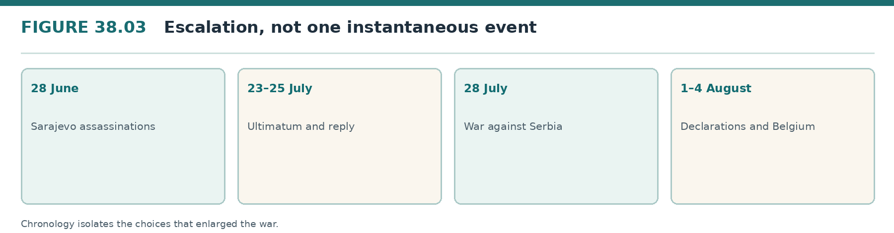

Босна и Херцеговина е била окупирана и управлявана от Австрия-Унгария от 1878 г. и официално приложена през 1908 г. Неговите жители включвали мюсюлмани, православни християни, католици и други, чиито политически идентичности не се подреждали добре. Някои южнославянски активисти потърсиха съюз със Сърбия или по-широка южнославянска държава; други подкрепиха различни договорености или се противопоставиха на революционното насилие. Групата, известна по-късно като "Млада Босна," беше свързана с разнообразни политически идеи. Гаврило Принцип е бил един от няколкото конспиратори. Елементите на сръбската тайна мрежа, включително фигурите, свързани с Черната ръка и военното разузнаване, подкрепиха заговора.

Съществено разграничение е между действията на конспираторите, участието на определени сръбски офицери и отговорността на сръбското гражданско правителство. Доказателствата за нелегална помощ са много по-силни от всички твърдения, че всички сръбски политически власти са наредили убийството. Смъртта на Франц Фердинанд предизвика престижа и сигурността на Хабсбург, но не доказа, че е необходимо да се унищожи сръбският суверенитет. За да оценят последващата криза, попитайте какво знаят следователите, какво подозират длъжностните лица и какво са готови да рискуват в преследване на по-широка политическа цел. \[<a href="/038-world-war-i-causes-and-consequences/sources/#source-1" class="cite">1</a>\]\[<a href="/038-world-war-i-causes-and-consequences/sources/#source-6" class="cite">6</a>\]

<figure class="figure" id="figure-38-3">

<figcaption>Фигура 38.3. Ескалация, нито едно мигновено събитие <a class="figure-anchor" href="#figure-38-3" aria-label="Link to this figure">#</a></figcaption>
</figure>
