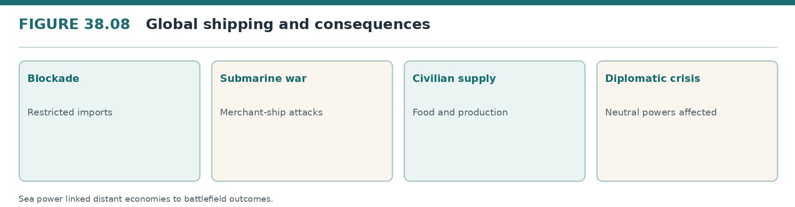

Кралската флота и съюзническите флотилии се опитват да контролират морските маршрути и да ограничат вноса на доставки в Централните сили. Германия използва подводници срещу търговски кораби и понякога пътнически кораби, създаващи дипломатически кризи над закона за военноморската война и живота на неутралните. Потъването на Луситания през май 1915 г. става особено видно, но Съединените щати не влизат във войната веднага. Британската блокада и германските контрамерки засегнаха храните, горивата, търговията, застраховането и промишленото производство.

Военноморската война включвала повърхностни битки, мини, конвои и защита на императорските комуникации. Битката при Ютландия през 1916 г. е голям ангажимент флот, но стратегическият въпрос не е решен чрез преброяване на корабите, изгубени в един ден. През 1917 г. немските лидери възобновиха неограничената си подводна война с надеждата Великобритания да падне на колене, преди американската намеса да има решаващи последици. Този хазарт вместо това е помогнал на Съединените щати да влязат в конфликта. Картата на корабоплаването е също толкова важна тук, колкото и карта на окопите, защото способността да се хранят населението и фабриките за доставки зависи от моретата. \[<a href="/038-world-war-i-causes-and-consequences/sources/#source-17" class="cite">17</a>\]\[<a href="/038-world-war-i-causes-and-consequences/sources/#source-18" class="cite">18</a>\]

<figure class="figure" id="figure-38-8">

<figcaption>Фигура 38.8. Глобално корабоплаване и последици <a class="figure-anchor" href="#figure-38-8" aria-label="Link to this figure">#</a></figcaption>
</figure>
