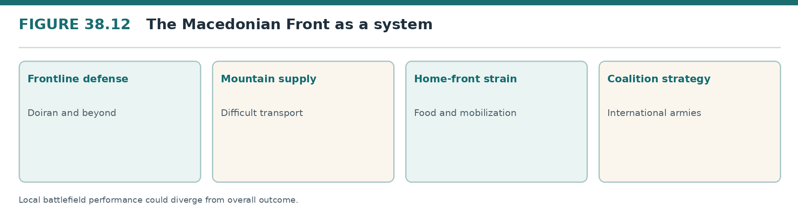

Съюзниците създадоха сили около Солун, често наричани Салоника в съвременни английски сметки, а фронтът в крайна сметка се простираше в широк регион на Южна Македония и съседни райони. Френски, британски, сръбски, италиански, руски и гръцки контингенти служиха по различно време, докато българските сили създадоха голяма част от противниковата линия заедно с немския и друг персонал на Централните сили. Труден планински терен, летни болести, кални транспортни маршрути и сложни мултинационални команди възпрепятстваха операциите. И двете страни изградиха защитни позиции, но линията не беше географски идентична с непрекъснатата мрежа на Западния фронт.

За България фронтът изискваше войници, боеприпаси, транспорт на животни и храна година след година. Битките около Дойран илюстрираха силни отбранителни резултати на българските войски в няколко операции, но успехът на местна позиция не можеше да гарантира оцеляването на по-широкия фронт. Войниците също трябваше да претеглят трудностите на собствените си семейства у дома. Стратегически важен фронт може да бъде забравен в по-късните глобални разкази, защото последната криза се появява другаде; балканския театър все пак изигра централна роля в колапса на Централните сили през 1918 г. \[<a href="/038-world-war-i-causes-and-consequences/sources/#source-25" class="cite">25</a>\]\[<a href="/038-world-war-i-causes-and-consequences/sources/#source-27" class="cite">27</a>\]

<figure class="figure" id="figure-38-12">

<figcaption>Фигура 38.12. Македонският фронт като система <a class="figure-anchor" href="#figure-38-12" aria-label="Link to this figure">#</a></figcaption>
</figure>
