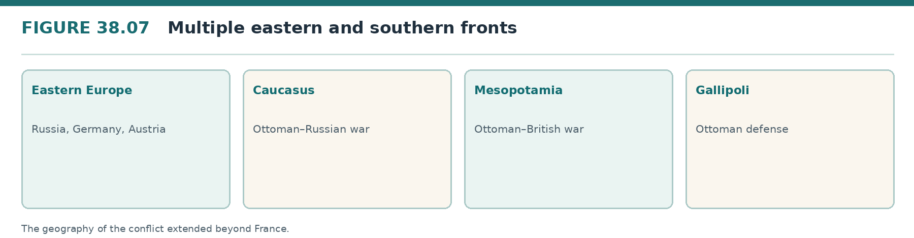

Османската империя влиза във войната на страната на Централните сили в края на 1914 г. след сложна поредица от дипломатически и военноморски решения. Нейните сили се сблъскаха с Русия в Кавказ и Британската империя в Месопотамия, Синай и Палестина. Кампанията на Съюзниците Галиполи от 1915 г. се стреми да принуди Дарданелите и да промени стратегическата ситуация, но Османската отбрана предотврати надежда за пробив. Болестта, трудният терен, неадекватните доставки и провалите на командването формираха тези кампании толкова, колкото и тактиката на бойното поле.

Великобритания се опита да защити имперските маршрути и стратегически ресурси, докато османските лидери се бореха да защитят разнообразна империя под икономически и политически стрес. Арабските сили се присъединиха към различни страни по причини, включващи местни съперничество, възможности и стремежи за самоуправление. Третирайки арабския бунт като спонтанен глас на всеки арабски жител би пренебрегнал разделението между общностите. Британците напредват през Палестина и Месопотамия, сраженията в Кавказ и конкурса по морски маршрути направиха войната глобална във военен обхват и създадоха спорове, които ще продължат след османското поражение. \[<a href="/038-world-war-i-causes-and-consequences/sources/#source-13" class="cite">13</a>\]\[<a href="/038-world-war-i-causes-and-consequences/sources/#source-14" class="cite">14</a>\]

<figure class="figure" id="figure-38-7">

<figcaption>Фигура 38.7. Множество източни и южни фронтове <a class="figure-anchor" href="#figure-38-7" aria-label="Link to this figure">#</a></figcaption>
</figure>
