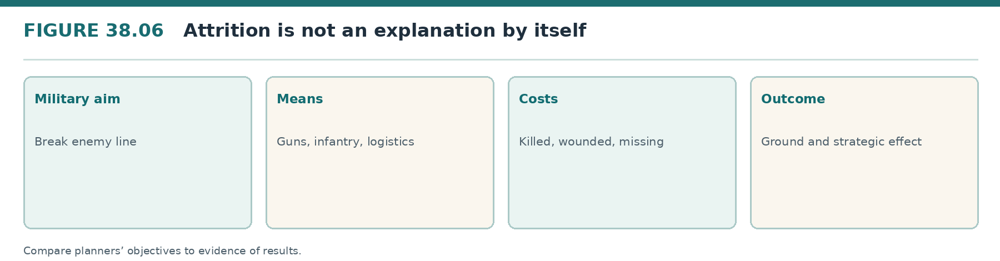

Битката при Вердюн 1916 се превръща в траен символ на издръжливостта на френската армия и ужасяващите човешки разходи за продължителни операции. Битката при Сома, започнала от британските и френски армии през юли 1916 г., също води до стотици хиляди жертви в продължение на месеци. Първият ден от британската офанзива беше особено опустошителен. Точната сума на жертвите варира в зависимост от определенията за убити, ранени, изчезнали и лишени от свобода, както и от периода, който е включен. Трябва да се противопоставим на използването на огромни числа като заместител на обясняването на стратегическите цели и условията на бойното поле.

Атрицията не означава просто, че генералите искат да убият възможно най-голям брой опоненти. Някои командири смятаха, че повтарящите се атаки могат да отслабят резервите на врага или да разбият отбранителните системи; други бяха ограничени от политически искания за подкрепа на съюзниците. Тези изчисления могат да се окажат много погрешни. Оценката на офанзивата включва питане какво се надяват да постигнат неговите организатори, каква информация притежават, как са били разпределени загубите и дали последствията от нея оправдават разходите му. Паметта по-късно превърна Вердюн и Соме в национални символи, но националния спомен не е същият като пълния отчет на събитията. \[<a href="/038-world-war-i-causes-and-consequences/sources/#source-7" class="cite">7</a>\]\[<a href="/038-world-war-i-causes-and-consequences/sources/#source-9" class="cite">9</a>\]

<figure class="figure" id="figure-38-6">

<figcaption>Фигура 38.6. Атрицията сама по себе си не е обяснение. <a class="figure-anchor" href="#figure-38-6" aria-label="Link to this figure">#</a></figcaption>
</figure>
