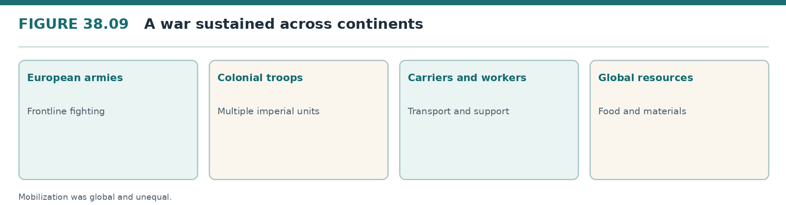

Европейските колониални империи довеждат войници, работници, моряци и ресурси от целия свят в конфликта. Индийски войници са служили в Европа, Близкия изток и други театри. Африкански единици, включително френските колониални сили и войски от британските притежания, се борили и доставяли армии. Военните кампании в Източна Африка включваха немски колониални войски, африкански катарис и огромен брой превозвачи, чиито принудителен или притискан труд ги излагаше на болести, изтощение и опасност. Япония се присъедини към съюзническата страна, иззе немските стопанства в Китай и Тихия океан и използва конфликта, за да преследва регионални амбиции.

Един глобален разказ трябва да изследва неравноправните отношения в рамките на тези сили. Някои мъже били доброволци за заплащане, лоялност, статут или местна възможност; други били мобилизирани или вербувани чрез принудителни структури. Техният опит може да доведе до искания за политическо признание след войната, но не всеки ветеран става националист. Африкански и азиатски цивилни са изправени пред реквизиции, преместване и нарушаване на търговията. Войната в Европа никога не е била само европейска, дори ако много европейски възпоменания се съсредоточат върху Западния фронт. \[<a href="/038-world-war-i-causes-and-consequences/sources/#source-20" class="cite">20</a>\]\[<a href="/038-world-war-i-causes-and-consequences/sources/#source-21" class="cite">21</a>\]

<figure class="figure" id="figure-38-9">

<figcaption>Фигура 38.9. Войната продължила през континентите. <a class="figure-anchor" href="#figure-38-9" aria-label="Link to this figure">#</a></figcaption>
</figure>
