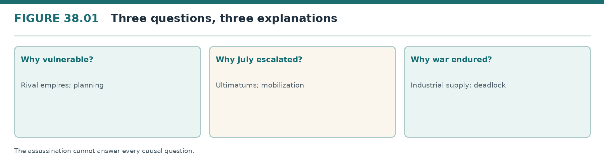

Има поне три различни исторически въпроса: защо Европа е била уязвима към война, защо кризата през юли 1914 г. ескалира и защо последвалата борба продължи повече от четири години. Отговорите, които са подходящи за един въпрос, не могат просто да бъдат използвани повторно за друг. Националистическата възбуда помага да се обясни конфликтът в Босна, но не обяснява напълно британската военноморска политика или борбата в Месопотамия. Съюзите засегнаха очакванията по време на кризата, но те не диктуваха пряко всяко решение на правителството. Индустриалното производство обяснява как армиите са понесли ужасни загуби, но не ни казва много за мотивите на убийците от Сараево.

Един полезен причинен модел разделя фоновите условия, незабавните решения и военните механизми. Фонът включваше императорска конкуренция, национализъм, мобилизиращи системи и страхове от упадък. Незабавните решения включват ултиматума на Австрия-Унгария, подкрепата на Германия, мобилизацията на Русия, френските дипломатически ангажименти и нахлуването на Германия в Белгия. Механизмът на продължителна война включваше отбранителна огнева мощ, военно обучение, икономически ресурси, политически ангажименти и трудности при постигането на договорено споразумение, когато правителствата се опасяваха, че поражението ще бъде катастрофално. Историците оспорват относителната тежест на тези фактори; една сериозна книга не трябва да превръща един завладяващ лозунг в изключително обяснение. \[<a href="/038-world-war-i-causes-and-consequences/sources/#source-1" class="cite">1</a>\]\[<a href="/038-world-war-i-causes-and-consequences/sources/#source-3" class="cite">3</a>\]

<figure class="figure" id="figure-38-1">

<figcaption>Фигура 38.1. Три въпроса, три обяснения. <a class="figure-anchor" href="#figure-38-1" aria-label="Link to this figure">#</a></figcaption>
</figure>
