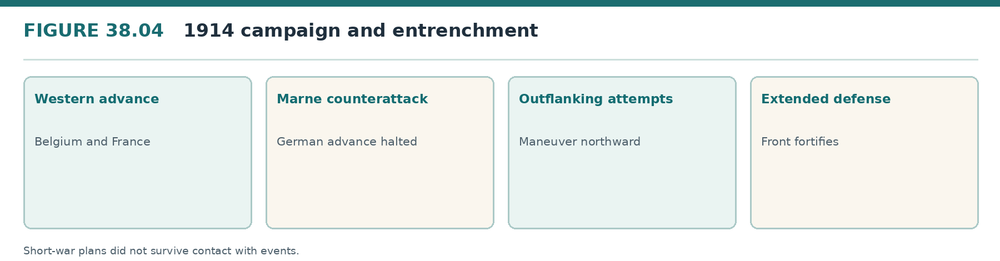

Историците спорят за отговорността от 1914 г. насам. Съвременните правителства публикуваха избрани дипломатически документи, за да защитят решенията си. Мирното споразумение от 1919 г. възлага значителна правна отговорност на Германия и нейните съюзници, но историческият въпрос е по-широк от текста на договора. Учените обсъждат до каква степен германската подкрепа даде възможност за ескалация на Хабсбург, дали Виена е била решена да се бори, как руската мобилизация е променила кризата и дали френската и британската дипломация биха могли реалистично да я спрат. Твърденията не са еднакво подкрепени само защото съществуват; доказателствата все още имат значение.

Най-силното обяснение отличава агенцията от контекста. Сръбското националистическо насилие беше от значение, а нелегалната подкрепа заслужава проверка. Австрийците избраха изключително конфронтационна политика. Германските лидери приеха сериозни рискове и избраха да водят война срещу Франция чрез Белгия. Руски и френски лидери поеха последващи ангажименти и изчисления. Британското колебание и по-късната намеса принадлежаха към отделен процес на вземане на решения. Вместо да се опитваме да идентифицираме един единствен, защото той освобождава всички останали и да питаме кои решения са направили общата европейска война по-вероятна и как са се появили надеждни алтернативи тогава. \[<a href="/038-world-war-i-causes-and-consequences/sources/#source-1" class="cite">1</a>\]\[<a href="/038-world-war-i-causes-and-consequences/sources/#source-3" class="cite">3</a>\]

<figure class="figure" id="figure-38-4">

<figcaption>Фигура 38.4. Кампания от 1914 г. и укрепване <a class="figure-anchor" href="#figure-38-4" aria-label="Link to this figure">#</a></figcaption>
</figure>
