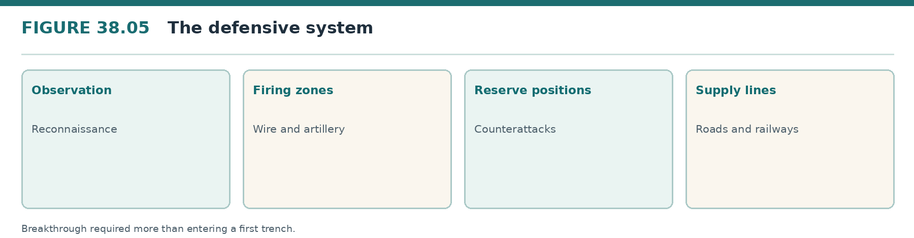

Окопа не беше просто дълга дупка. Една зряла отбранителна система може да съдържа позиции на фронтовата линия, комуникационни окопи, резервни линии, прокопаеми места, наблюдателни постове, артилерийски зони и транспортни маршрути. Барбад е забавил нападателите, докато картечниците и артилерията са наказвали незащитеното движение. Защитниците могат да преместят подкрепления по железопътни линии и пътища по-лесно, отколкото нападател може да премине през повредена от снаряд земя. Така местният тактически успех може да не успее да се превърне в оперативен пробив.

Балансът се промени по време на войната. Артилеричните техники се подобряват; въздухоплавателните средства осигуряват разузнаване; танковете се появяват през 1916 г.; пехотата и артилерията са координирани по-ефективно; а армиите се научават как да изграждат защити в дълбочина. Нямаше нито едно постоянно превъзходство на отбраната, а последните кампании от 1918 г. включваха големи постижения. Въпреки това военните командири са изправени пред ужасна аритметика: едно правителство може да притежава достатъчно хора и черупки, за да продължи да атакува, без да притежава метод за превръщане на жертвите в решителна победа. \[<a href="/038-world-war-i-causes-and-consequences/sources/#source-7" class="cite">7</a>\]\[<a href="/038-world-war-i-causes-and-consequences/sources/#source-9" class="cite">9</a>\]

<figure class="figure" id="figure-38-5">

<figcaption>Фигура 38.5. Отбранителната система. <a class="figure-anchor" href="#figure-38-5" aria-label="Link to this figure">#</a></figcaption>
</figure>
