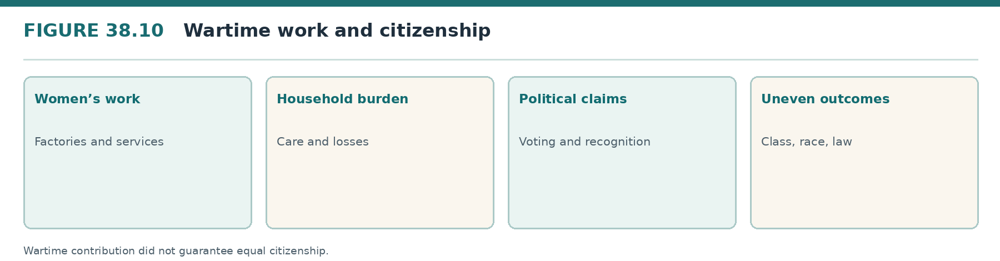

Жените служеха като медицински сестри, чиновници, земеделски работници, транспортни работници, работници с боеприпаси и организатори на социални и протестни движения. Тяхната работа поддържа армии и домакинства, но военновременните модели на заетост се различават значително по страни, клас и регион. Някои професии станаха по-достъпни, докато жените можеха да бъдат изключени от по-високостатистически позиции или принудени да напуснат работните места след демобилизация. Смъртта от войната и нараняванията са оставили милиони домакинства, изправени пред загуба на доходи, скръб и променени семейни взаимоотношения.

Твърде просто е да се твърди, че Първата световна война веднага освобождава жените. Бунтовниците се разширяват в някои страни около края на войната, но кампаниите за правата на глас отдавна са предшественици от 1914 г. и много жени остават политически изключени. Военната служба може да засили претенциите за гражданство, но жените в колониалните общества и маргинализирани общности често са изправени пред допълнителни бариери. Анализирайте промяната чрез конкретни закони, работни места и домакинства, а не обща история за неизбежен напредък. Способността да се допринесе за оцеляването на страната не е довела автоматично до равен достъп до политическите институции на нацията. \[<a href="/038-world-war-i-causes-and-consequences/sources/#source-22" class="cite">22</a>\]\[<a href="/038-world-war-i-causes-and-consequences/sources/#source-23" class="cite">23</a>\]

<figure class="figure" id="figure-38-10">

<figcaption>Фигура 38.10. Военна работа и гражданство <a class="figure-anchor" href="#figure-38-10" aria-label="Link to this figure">#</a></figcaption>
</figure>
