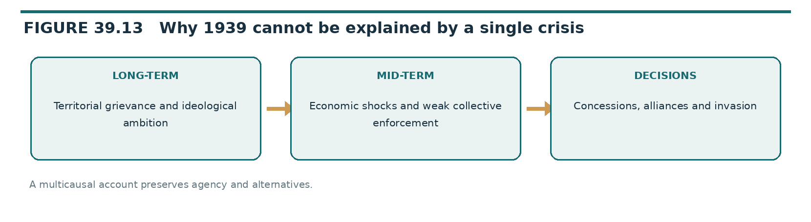

През август 1939 г. Германия и Съветският съюз сключват пакт за ненападение с тайни протоколи, разделящи сферите на влияние в Източна Европа. Германия нахлува в Полша на 1 септември 1939 г.; Великобритания и Франция обявяват война на Германия на 3 септември. Съветските сили нахлуха в Източна Полша на 17 септември. Европейският междувоенен период приключи в избухването на нова голяма война, въпреки че Китай и други региони вече бяха подложени на обширна война. Глава 40 ще изследва войната и Холокоста в тяхната пълна хронология. \[<a href="/039-the-interwar-world/sources/#source-2" class="cite">2</a>\]\[<a href="/039-the-interwar-world/sources/#source-39" class="cite">39</a>\]

Главният урок не е, че мирът е бил невъзможен след 1918 г. Международните институции постигнаха реална работа, обществата развиха демократични реформи и много страни запазиха конституционното правителство въпреки кризата. Но нерешените териториални претенции, слабото колективно прилагане, икономическата взаимозависимост без адекватно управление на кризите, идеологическото преследване и изчислената агресия се оказаха опустошителни в комбинация. Доброто обяснение прави човешките избори видими: икономическите шокове създават опасности; режими и лидери решават как да реагират; други правителства избират на какво да се противопоставят или толерират. Ето защо междувоенният свят трябва да се изучава не като неизбежен предговор, а като поле от възможности, които стесняват времето.

<figure class="figure" id="figure-39-13">

<figcaption>Фигура 39.13. Защо 1939 г. не може да се обясни с нито една криза? Мултикаузалната сметка запазва агенцията и алтернативите. <a class="figure-anchor" href="#figure-39-13" aria-label="Link to this figure">#</a></figcaption>
</figure>
