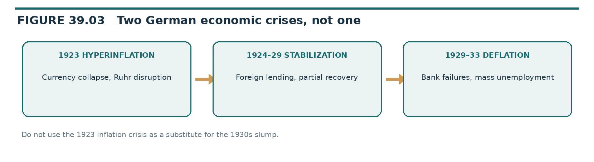

От средата на 20-те години на XX век много европейци преживяват смислена стабилизация. Планът "Доус" от 1924 г. пренареди аспектите на германския график за репарации и помогна за възстановяването на международното кредитиране; споразуменията от Локарно от 1925 г. се опитаха да намалят конфликта над западните граници на Германия; Германия влезе в Лигата на народите през 1926 г. Международната търговия и потребителските индустрии са нараснали в части на света. Ерата не беше нито равномерно процъфтяваща, нито непрекъснат поход към катастрофа. \[<a href="/039-the-interwar-world/sources/#source-1" class="cite">1</a>\]\[<a href="/039-the-interwar-world/sources/#source-7" class="cite">7</a>\]

Стабилизацията се основава отчасти на кредитните потоци, уязвими към обръщане. Американският капитал премина през Атлантическия океан; европейските кредитополучатели зависеха от рефинансирането; износителите зависеха от пазарите, които биха могли да се договорят. Националните икономики са свързани в сложни мрежи от дългове, златни резерви, инвестиции и доверие. Просперирането на една градска фабрика може да съществува едновременно с намаляващите селскостопански доходи, миграцията в селските райони и неразрешената безработица. Икономическият ред изглеждаше по-устойчив в края на 20-те години, отколкото може да се окаже. Един читател трябва да избягва два ретроспективни мита: че всеки процъфтява в "Roaring Twenties," и че не е имало смислен напредък. \[<a href="/039-the-interwar-world/sources/#source-7" class="cite">7</a>\]\[<a href="/039-the-interwar-world/sources/#source-9" class="cite">9</a>\]

<figure class="figure" id="figure-39-3">

<figcaption>Фигура 39.3. Две немски икономически кризи, не една. Не използвайте инфлационната криза през 1923 г. като заместител на спадът през 30-те години на миналия век. <a class="figure-anchor" href="#figure-39-3" aria-label="Link to this figure">#</a></figcaption>
</figure>
