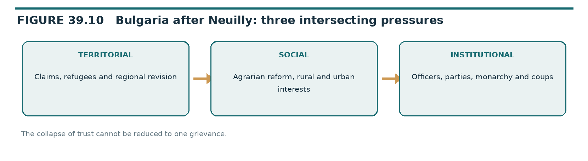

За България междувоенните години започнаха след военни поражения, териториални загуби, задължения за репарации, бежански натиск и политическо разочарование. Договорът от Neuilly от ноември 1919 година налага условия и потвърждава трудно регионално уреждане. Твърденията относно Македония, Западна Тракия и Южна Добруя останаха важни в обществения дебат, въпреки че правното положение и политическият статут на тези територии не бяха идентични. Бежанците и ветераните пренасят последствията от войната в общности, които вече са натоварени с недостиг. \[<a href="/039-the-interwar-world/sources/#source-33" class="cite">33</a>\]\[<a href="/039-the-interwar-world/sources/#source-34" class="cite">34</a>\]

Александър Стамболийски и Българският аграрен национален съюз се застъпиха за политика, съсредоточена върху селяните, аграрните интереси и реформите, които предизвикаха установените елити. Неговото правителство следваше наземни и образователни мерки и търсеше различен регионален курс, включително настаняване в Югославия. Поддръжниците видяха демократична социална реформа за до голяма степен населението на селските райони; опонентите критикуваха принудителните тенденции, конфликтите с градския елит и натиска върху съперническите политически организации. Стамболийски не може да се опише точно като безупречен демократ или обикновен авторитарен. Неговите политики и методи изискват отделен анализ. \[<a href="/039-the-interwar-world/sources/#source-33" class="cite">33</a>\]\[<a href="/039-the-interwar-world/sources/#source-34" class="cite">34</a>\]

<figure class="figure" id="figure-39-10">

<figcaption>Фигура 39.10. България след Ньойли: три пресичащи се натиска. Срутването на доверието не може да бъде сведено до едно оплакване. <a class="figure-anchor" href="#figure-39-10" aria-label="Link to this figure">#</a></figcaption>
</figure>
