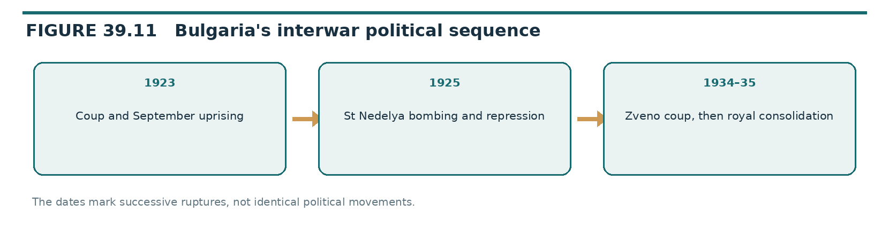

Икономиката на България остана силно аграрна и уязвима на международните цени на суровините. Глобалната депресия обтегна фермерите, търговията и публичните финанси, въпреки че опитът се различаваше от индустриалната масова безработица в Германия или САЩ. Политическите коалиции останаха крехки. На 19 май 1934 г. политическият кръг на Zveno и Военната лига организираха нов преврат под командването на Кимон Георгиев. Новите управници прекратиха парламентарния конкурс и преследваха административна централизация, като същевременно предприемат стъпки срещу организации, които оспорват властта им. \[<a href="/039-the-interwar-world/sources/#source-34" class="cite">34</a>\]\[<a href="/039-the-interwar-world/sources/#source-36" class="cite">36</a>\]

Цар Борис III постепенно изселва създателите на преврати и консолидира по-лично кралско управление от 1935 г., вместо да върне България в обикновеното конкурентно парламентарно правителство. Външната политика все повече се фокусира върху мирната териториална ревизия и поддържането на място за маневриране на фона на съпернически велики сили. Курсът на монархията бил ограничен от страхове за сигурност и икономическа зависимост, но ограничените избори все още били избор. През 1939 г. България все още не се е присъединила към Втората световна война; нейният по-късен военновременен съюз и опитът на българските евреи принадлежат към следващата глава. Междувоенна България илюстрира как регионални оплаквания, военна намеса, социален конфликт и институционално недоверие взаимодействат без да правят нито един неизбежен изход. \[<a href="/039-the-interwar-world/sources/#source-34" class="cite">34</a>\]\[<a href="/039-the-interwar-world/sources/#source-36" class="cite">36</a>\]

<figure class="figure" id="figure-39-11">

<figcaption>Фигура 39.11. Междувоенната политическа последователност на България. Датите бележат последователни разкъсвания, а не идентични политически движения. <a class="figure-anchor" href="#figure-39-11" aria-label="Link to this figure">#</a></figcaption>
</figure>
